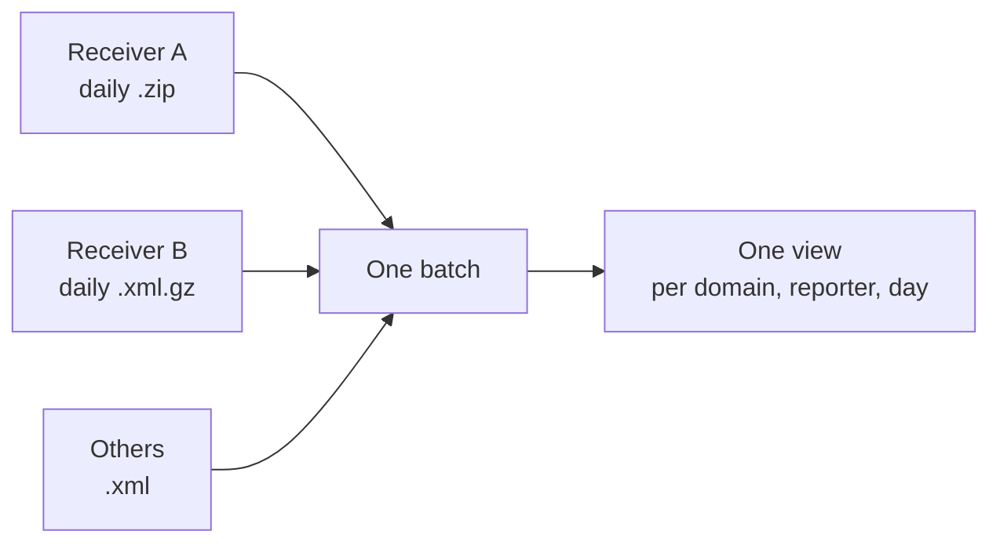

# REQ-DMARC-003: Combine many reports from many receivers

Status: Accepted

## Need

- Each receiver sends one report per policy domain per day (RFC 9990 §3.1). A week for one domain is dozens of files.
- One report alone says little. The useful picture comes from all receivers together.
- Receivers resend reports. Two copies must not count twice (RFC 9990 §3.5.4).

## Requirement

- Users can drop many files at once, and add more later. Each drop adds to the loaded set; "Clear" empties it.
- The analyzer accepts plain XML, gzip-compressed XML, and ZIP archives of XML or gzip files.
- A report that was already loaded is counted once, with a finding.
- All totals, charts, and tables can be filtered by policy domain, reporter, and date range.
- Changes in the published policy within the loaded period are shown (RFC 9990 §3.3).

## Rationale

- RFC 9990 §3.5.2 says reports SHOULD be gzipped. Some large receivers send ZIP archives instead, so both must open.
- Combining by reporter and day shows gaps, such as a receiver that stopped reporting.

## Alternatives rejected

| Alternative | Why not |
|---|---|
| One report at a time | Users ask about the whole mail stream across receivers and days |
| Keep reports in browser storage between visits | Report data would persist on disk; users can drop the files again |

## Acceptance

- Dropping the same file twice counts its messages once and shows a duplicate finding.
- A batch with reports for two domains can be filtered to one; every number changes with it.
- A ZIP holding one gzip-compressed report opens.

## Specified in

- [Input](../../reference/dmarc-aggregate/input.md), [Combining reports](../../reference/dmarc-aggregate/combine.md)
