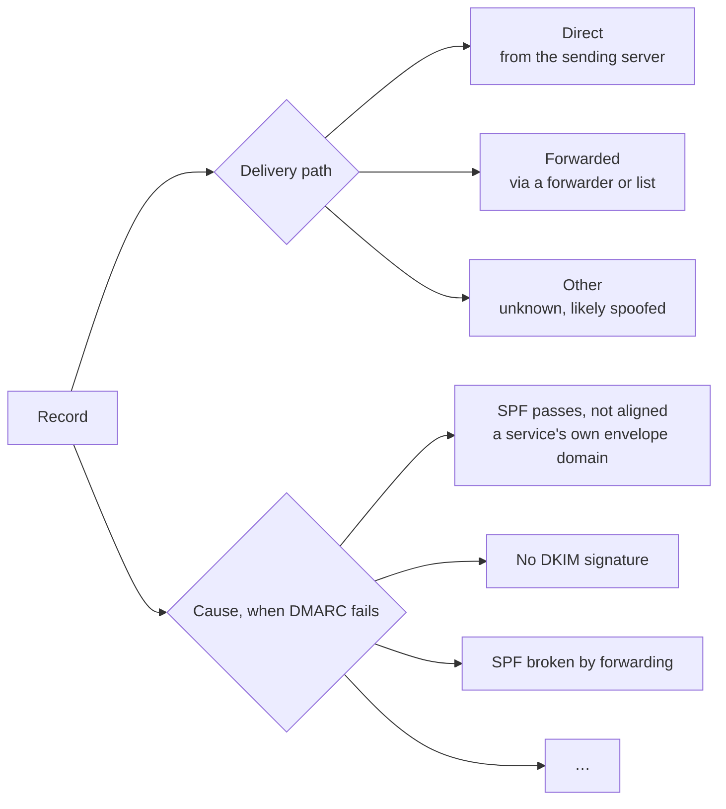

# REQ-DMARC-005: Classify delivery paths and causes of failure

Status: Accepted

## Need

- A failing source is either the owner's own mail that is set up wrong, legitimate mail that was forwarded, or someone else using the domain.
- These need different actions: fix the setup, accept the loss or rely on receivers, or block.
- Reports do not say which case applies. The facts in them do point to it, in recognizable patterns.

## Requirement

- Every record gets a delivery path: direct, forwarded, or other.
- Every DMARC-failing record gets one cause from a fixed list. It includes at least: SPF passes but does not align, DKIM passes but does not align, no DKIM signature, DKIM signature broken in transit, SPF broken by forwarding, temporary error, permanent error, nothing authenticates.
- Each classification shows the rule that made it and the facts it used.
- The UI labels these as estimates from report data.
- Classification uses only report data, so it gives the same result with reverse lookup on or off.

## Rationale

- RFC 9989 §5.1.6 asks owners to tell legitimate unaligned streams from abuse before they enforce. This is the sorting step.
- RFC 9989 §7.4: relayed mail usually fails SPF while DKIM survives. That pattern is visible in reports.
- Showing the rule and facts lets users disagree with the estimate.

## Alternatives rejected

| Alternative | Why not |
|---|---|
| Scores or machine learning | Not explainable; no training data that we could ship |
| Use host names (reverse DNS) to classify | Lookups are optional; results would change with a setting |
| Use a list of known forwarders and services | Goes stale; would need updates and bias the result |

## Acceptance

- DKIM aligned pass with SPF `fail` is classified as forwarded.
- SPF `pass` for an unrelated domain, without aligned DKIM, is classified as direct with the cause "SPF passes, not aligned".
- No DKIM and SPF `fail`, from a source with no other evidence, is classified as other with the cause "no DKIM signature".
- A failing record from an IP that other records show to be a forwarder is classified as forwarded, cause "SPF broken by forwarding".

## Specified in

- [Classification](../../reference/dmarc-aggregate/classify.md)
- Design: [0016](../decisions/0016-dmarc-aggregate-classify.md)
