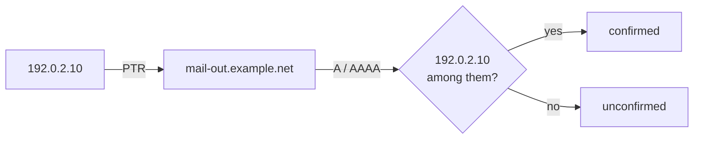

# REQ-DMARC-008: Optional reverse lookup of source IPs

Status: Accepted

## Need

- An IP address alone says little. A host name such as `mail-out.example.net` often names the service.
- A reverse lookup puts the source IP into the query name, for example `10.2.0.192.in-addr.arpa`. The DoH provider sees which IPs the user is curious about.
- The mail analyzer treats such queries as sensitive and blocks them by default ([REQ-MAIL-010](REQ-MAIL-010-dns-control.md)).

## Requirement

- Reverse lookup is off by default. The control that turns it on names the DoH provider and says that source IPs are sent.
- Turning it on looks up the PTR of the sources in the filtered set, with a fixed limit.
- Each name is checked forward. Only names that map back to the IP are shown as confirmed (RFC 8601 §3).
- Every query is listed.
- Host names are shown only. They never change classification (REQ-DMARC-005).

## Rationale

- Source IPs in reports belong to mail servers, not to individuals (RFC 9990 §7.2). They still map the owner's infrastructure, so the user decides.
- PTR records are set by the IP owner. Anyone can publish a misleading name. Forward confirmation removes the cheapest lies.

## Alternatives rejected

| Alternative | Why not |
|---|---|
| Always look up | Contradicts "nothing leaves by default" (REQ-DMARC-001) |
| Never look up | Users would copy IPs into other tools, which leaks more |
| Bundle an IP-to-owner database | Large and stale |

## Acceptance

- With lookup off, no request is made.
- With lookup on, a PTR name whose A records do not include the IP is shown as unconfirmed.
- The query log lists each PTR, A, and AAAA query.

## Specified in

- [Reverse DNS](../../reference/dmarc-aggregate/reverse-dns.md)
