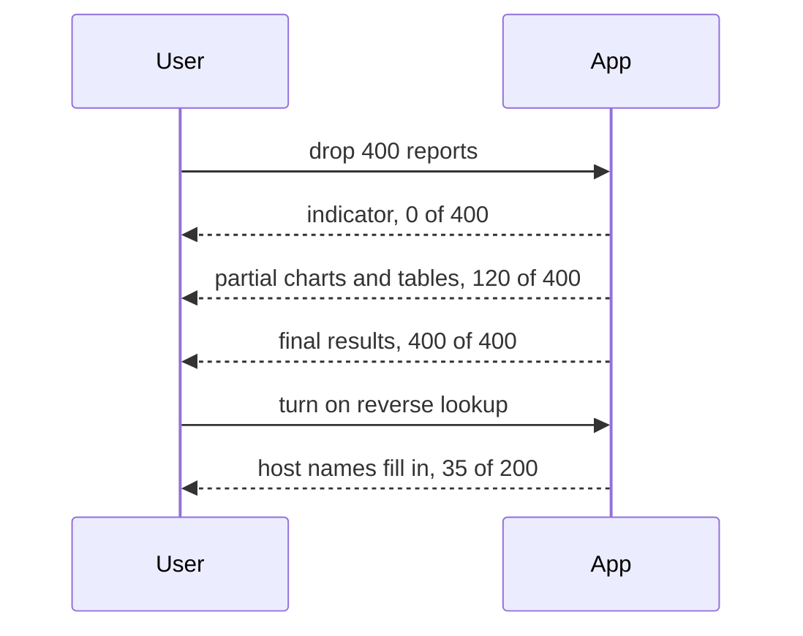

# REQ-DMARC-010: Show results while the analysis runs

Status: Accepted

## Need

- A year of reports for a busy domain is thousands of files. Reading them takes a while.
- Reverse lookups take one or more network round trips per source. Two hundred sources take tens of seconds.
- Users should see results as soon as some exist. They need to know that work is still running and how far it got, so that they never mistake a partial picture for the final one.

## Requirement

- While files are read, the charts, tables, and numbers update with the reports read so far.
- Host names appear in the source table as each lookup finishes.
- A visible indicator shows what is running, how far it is (files read of total; sources looked up of total), and when it is done.
- Partial results are labeled as partial.
- The user can stop the reading or the lookups. What was read so far stays.
- Filters keep working while the analysis runs.
- Updates do not take the user's place: expanded rows stay expanded and the scroll position stays.

## Rationale

- The first reports answer most questions. Waiting for the last file wastes the user's time.
- A determinate indicator (n of m) tells the user whether to wait or to stop.

## Alternatives rejected

| Alternative | Why not |
|---|---|
| Show results only when everything is done | Long waits with no feedback on large batches |
| Update on every record | Too many redraws; the page would stutter |
| A spinner without counts | Says nothing about how long the wait is |

## Acceptance

- With 400 files, partial results appear before the last file is read, labeled with the files read so far.
- The indicator shows "Reading files: n of 400" and then disappears with a "done" message for screen readers.
- After "Stop", the results cover the files read before it, and the files not read are listed.
- With lookups on, host names appear in rows while the indicator counts up.

## Specified in

- [Progress](../../reference/dmarc-aggregate/progress.md)
- Display: [DMARC aggregate report UI design](../dmarc-aggregate-design/ui.md)
