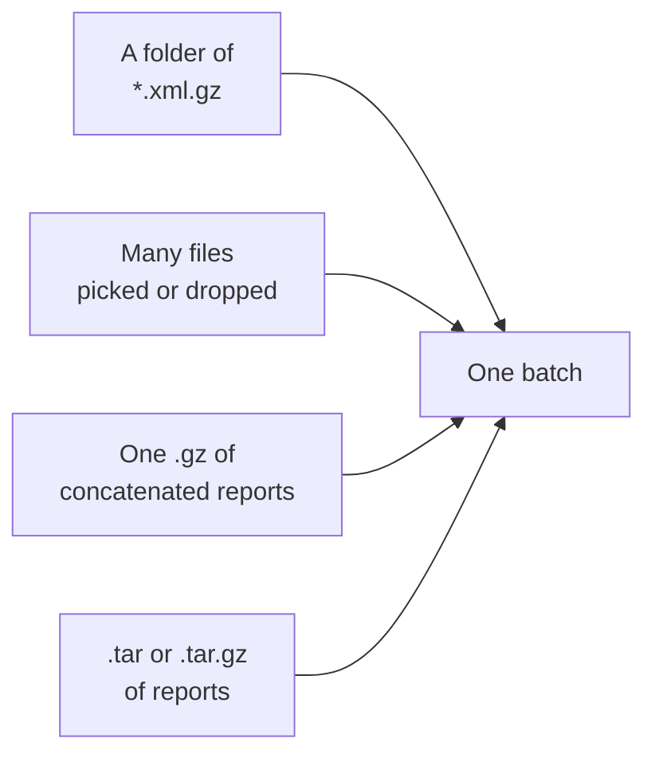

# REQ-DMARC-011: Take in many gzip reports at once

Status: Accepted

## Need

- Users collect reports from a mailbox into a folder, often one `.xml.gz` per receiver and day.
- Some users join them: `cat *.gz > week.gz` gives one gzip file with many members. Others archive them with `tar`.
- Picking hundreds of files one by one is not practical.

## Requirement

- The user can pick several files at once, pick a folder, or drop a folder. Folders are read with their subfolders.
- A gzip file may hold several reports: several gzip members, or several XML documents one after another.
- A tar archive, plain or gzipped, is opened, and each report in it is read.
- Each report keeps a label that says where it came from, such as `week.tar.gz › 2026/11/a.xml.gz`.
- Files in a folder that are not reports are skipped with one summary line, not one finding per file.

## Rationale

- These are the forms reports take after users save them. Asking users to unpack them first adds a step that other tools do not need.
- Labels keep each report traceable to its file (REQ-DMARC-009).

## Alternatives rejected

| Alternative | Why not |
|---|---|
| Require one report per file | Forces users to unpack archives by hand |
| Read every file in a folder as a possible report and report each failure | A folder of mail exports would flood the findings |

## Acceptance

- Dropping a folder with 3 `.xml.gz` files and a `README.txt` loads 3 reports and shows "1 file skipped: not a report".
- A gzip file made with `cat a.xml.gz b.xml.gz` loads 2 reports.
- A `.tar.gz` holding 2 `.xml.gz` files loads 2 reports.

## Specified in

- [Input](../../reference/dmarc-aggregate/input.md), [XML reader](../../reference/dmarc-aggregate/xml.md)
