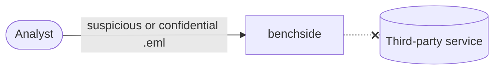

# REQ-MAIL-001: Analyze messages without sending them anywhere

Status: Accepted

## Need

- Users analyze phishing, confidential, or personal mail.
- They cannot paste it into an online service.

## Requirement

- The message must never leave the browser tab.
- The only network traffic is DNS lookups ([REQ-MAIL-010](REQ-MAIL-010-dns-control.md)).
- The browser must enforce this, not only our code.

## Rationale

- Trust by enforcement beats trust by promise.
- A CSP limits every script, including dependencies and workers.

## Alternatives rejected

| Alternative | Why not |
|---|---|
| Server-side analysis | Requires uploading the message |
| Browser extension | Install friction; broad permissions |

## Acceptance

- A browser test shows requests to any host outside the CSP are blocked, from the page and from the worker.
- With offline mode on, the network log shows no requests after page load.

## Specified in

- [DNS](../../reference/mail/dns.md)
- [Privacy model](../privacy-model.md), [0004](../decisions/0004-worker-from-blob-url.md)
