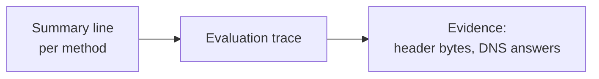

# REQ-MAIL-002: Explain every result with evidence

Status: Accepted

## Need

- A bare "fail" does not help. Users must see why.
- Users range from help-desk staff to mail administrators.

## Requirement

- The report starts with one line per method: SPF, DKIM, DKIM2, DMARC, ARC.
- Each line expands into the evaluation steps.
- Each step and finding links to the header bytes or DNS answers it used.
- "Not evaluated" is never shown as a failure, and always has a reason.

## Rationale

- Summary first serves quick triage.
- Evidence links serve experts and make the tool auditable.

## Acceptance

- Every finding in a report has at least one evidence link.
- Every "not evaluated" status has a reason.

## Specified in

- [Report](../../reference/mail/report.md)
