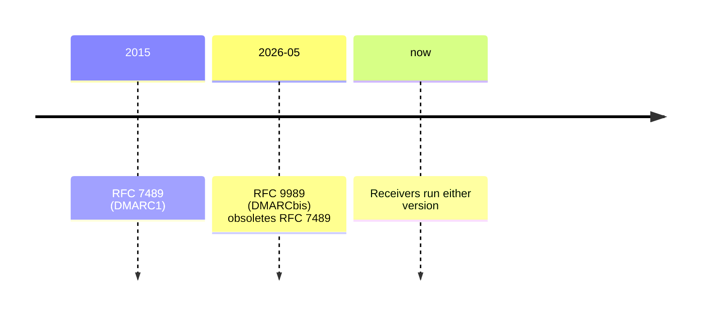

# REQ-MAIL-006: Evaluate DMARC under both versions

Status: Accepted

## Need

- Receivers are migrating. A domain owner needs to know the outcome under both.

## Requirement

- The user selects RFC 9989 (default) or RFC 7489. Both can be shown side by side.
- RFC 7489 mode uses the Public Suffix List, bundled as a snapshot.
- Show alignment for every SPF and DKIM identity, and the resulting disposition.

## Rationale

- Differences between versions (tree walk vs PSL, `pct` vs `t`) change outcomes for real domains.
- Bundling the PSL avoids another network origin ([0003](../decisions/0003-bundle-public-suffix-list.md)).

## Alternatives rejected

| Alternative | Why not |
|---|---|
| RFC 9989 only | Most receivers still run RFC 7489 today |
| Fetch the PSL at run time | Extra origin in the CSP; reveals usage |

## Acceptance

- A domain whose outcome differs between versions shows both outcomes and the reason.

## Specified in

- [DMARC](../../reference/mail/dmarc.md)
