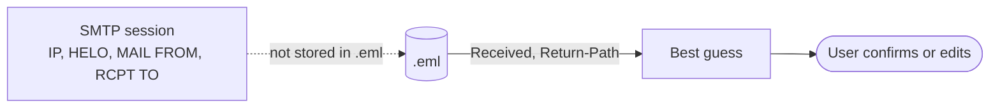

# REQ-MAIL-009: Inferred, editable delivery details

Status: Accepted

## Need

- SPF and DKIM2 need SMTP session data that a saved message does not contain.

## Requirement

- Infer the values from `Received`, `Return-Path`, and `Delivered-To`.
- The user can pick the trust-boundary `Received` field and edit every value.
- The report shows where each value came from.
- The user can choose the reference time for time-based checks.

## Rationale

- Guessing alone is often wrong (internal hops, unusual `Received` formats).
- Hiding the guess would make results look more certain than they are.

## Acceptance

- `Received` formats of Postfix, Exim, Sendmail, Microsoft Exchange, and Gmail are parsed in tests.
- Every inferred value names its source field.

## Specified in

- [Delivery details](../../reference/mail/envelope.md)
