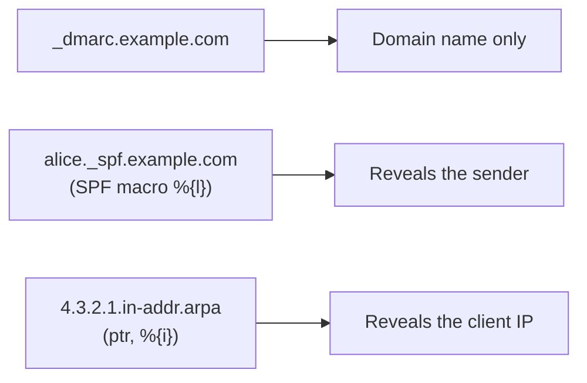

# REQ-MAIL-010: Control what DNS lookups reveal

Status: Accepted

## Need

- DNS lookups are the only traffic. Users must know what they reveal.
- SPF macros and `ptr` can put the sender's local part or the client IP address into a query name.

## Requirement

- Queries that would reveal more than domain names are blocked by default.
- The user can allow them for one analysis.
- Offline mode sends no queries at all; the user may enter records by hand.
- Every query is listed in the report.

## Rationale

- "Domain names only" must be true by default, not just usually true.

## Acceptance

- A test record using `%{l}` produces no query until the user allows it.
- In offline mode, no request is made.

## Specified in

- [DNS](../../reference/mail/dns.md), [SPF](../../reference/mail/spf.md)
