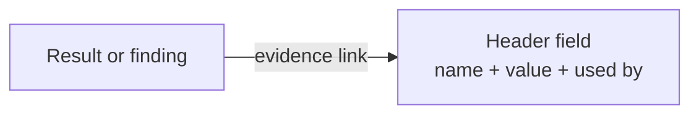

# REQ-MAIL-013: Show the header fields the checks read

Status: Accepted

Source: GitHub issue #1.

## Need

- Users want to check the results for themselves.
- Today the header list shows field names only. The values the checks read are not visible.

## Requirement

- The header field list shows the value of every field that sender authentication reads.
- Each such field says which checks read it.
- Fields no check reads keep showing their name only.
- Values are shown as written, with their folding. Spaces and tabs in the folding indent can be told apart, and so can any other tab.

## Rationale

- Evidence links already point at header fields. With the value there, a user can follow a link and read the field.
- Showing only the fields the checks read keeps the list short. Other fields are not part of the result.
- DKIM `simple` and `relaxed` canonicalization treat folding and tabs differently (RFC 6376 §3.4). A user checking a signature needs to see them.
- Values stay in the browser, like every other part of the report ([REQ-MAIL-001](REQ-MAIL-001-local-only.md)).

## Alternatives rejected

| Alternative | Why not |
|---|---|
| Show every field's value | Long lists; most fields do not affect the result |
| Mark every space | Values become hard to read; spaces inside text rarely matter, tabs and folding do |
| A separate raw-source view | Planned (`SourceView`), but much larger; this gives the values now |

## Acceptance

- For a message with `Received`, `Return-Path`, `From`, `DKIM-Signature`, ARC, and `Authentication-Results` fields, each one's value is shown with the checks that read it.
- A field signed by a DKIM signature (listed in `h=`) is marked as read by DKIM.
- A field no check reads shows no value.
- A folded value keeps its line breaks; each folding indent character reads `<SP>` or `<TAB>`, and every other tab reads `<TAB>`.

## Specified in

- [Report](../../reference/mail/report.md#header-fields): REP-9, REP-10
