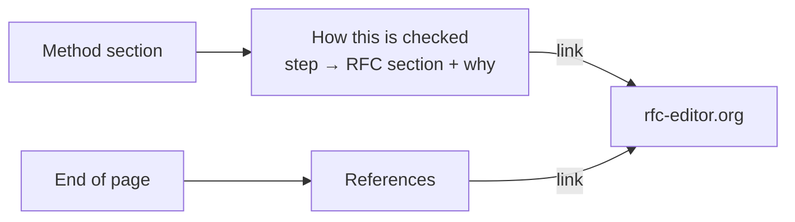

# REQ-MAIL-014: Cite the standard behind each step

Status: Accepted

Source: GitHub issue #2.

## Need

- Experts want to check the algorithm against the standards.
- Today the page shows results, but not which RFC section each step follows.

## Requirement

- Each method's section lists its evaluation steps.
- Each step links to the RFC section it follows and says in one line why the step is there.
- A References section at the end lists every RFC the analyzer follows, with links.

## Rationale

- Citing sections makes the tool auditable, like evidence links make results auditable ([REQ-MAIL-002](REQ-MAIL-002-explain-results.md)).
- The spec already cites the RFC sections per rule. The page shows the same citations to users.
- Links are plain navigation to rfc-editor.org. Nothing is fetched, and the CSP is unchanged. A link carries no message data ([REQ-MAIL-001](REQ-MAIL-001-local-only.md)).

## Alternatives rejected

| Alternative | Why not |
|---|---|
| Citations on findings only | Steps that passed have no finding, so most steps would have no citation |
| Quote the RFC text | Long, and the RFC is one click away |
| Link to the spec rules | The spec is for developers; users asked for the RFCs |

## Acceptance

- Every method section (delivery details, SPF, DKIM, DMARC per mode, ARC, receiver results) has its steps, each with an RFC section link and a reason.
- The References section lists each RFC once, with its number, title, and link.
- The citations on the page match the [citations reference](../../reference/mail/citations.md).

## Specified in

- [Citations](../../reference/mail/citations.md)
