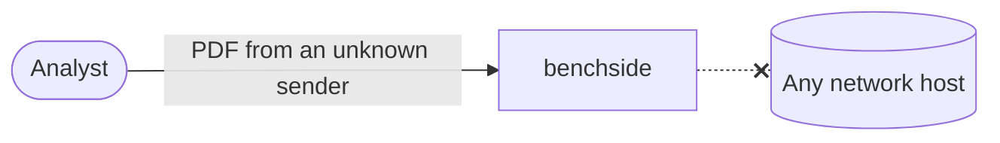

# REQ-PDF-001: Analyze PDFs without sending them anywhere

Status: Accepted

## Need

- Users inspect PDFs they do not trust or may not share: invoices, contracts, attachments from phishing mail.
- PDFs can be large; uploading them is slow as well as unsafe.

## Requirement

- The PDF must never leave the browser tab.
- The PDF analyzer makes no network requests at all.
- The browser must enforce this, not only our code.
- The analyzer never runs, renders, or follows anything inside the PDF: no JavaScript, no fonts, no links.

## Rationale

- Nothing in a structural analysis needs outside data.
- A CSP of `connect-src 'none'` limits every script, including the worker.
- Rendering or running PDF content is how malicious PDFs attack readers.

## Alternatives rejected

| Alternative | Why not |
|---|---|
| Use a PDF rendering library | Large; runs the content we are inspecting |
| Server-side analysis | Requires uploading the PDF |

## Acceptance

- The built PDF app's `index.html` carries the CSP with `connect-src 'none'`.
- The app's worker is started from a `blob:` URL, so it inherits that CSP ([0004](../decisions/0004-worker-from-blob-url.md)).

## Specified in

- [PDF analyzer specification](../../reference/pdf/README.md)
- [Privacy model](../privacy-model.md)
