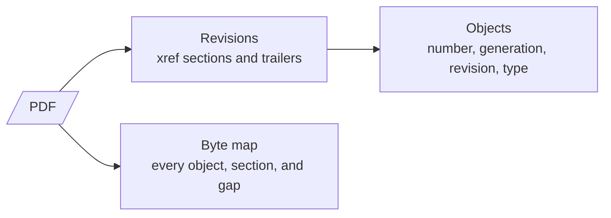

# REQ-PDF-002: Show the file structure

Status: Accepted

## Need

- A PDF is a set of objects plus cross-reference sections that say where each object is.
- Every save can append a new revision. Earlier revisions stay in the file.
- Users want to see this structure: which objects exist, which revision changed them, and what sits where in the file.
- PDF readers hide it. They show only the final pages.

## Requirement

- The analyzer shows the header version and every revision, newest first, with its cross-reference section and trailer.
- It reads both cross-reference tables and cross-reference streams, and hybrid files that use both.
- It lists every object the cross-reference information names: number, generation, where it is, the revision that defines it, and its `/Type`.
- It shows a byte map: every object and cross-reference section with its offset and length, and every non-blank byte range nothing accounts for.
- Malformed structure produces findings, not a crash. The analyzer shows as much as it could read.
- Each rule cites the ISO 32000-1 clause it comes from.

## Rationale

- Incremental updates are where edits, added signatures, and appended content live. Seeing revisions shows what changed after a document was first written.
- A byte map makes appended data and hidden content visible.
- Citing ISO 32000-1 lets users check the rule themselves.

## Alternatives rejected

| Alternative | Why not |
|---|---|
| Scan the whole file for `obj` keywords first | Slow on large files; readers use the cross-reference information. Rebuilding by scanning is for broken files only (a later requirement) |
| Show only the newest revision | Hides the history users came for |

## Acceptance

- A PDF with one incremental update shows two revisions and marks the objects the update replaced.
- A PDF 1.5 file with a cross-reference stream and object streams lists the compressed objects with their object stream and index.
- A PDF with bytes appended after `%%EOF` shows them as a separate region with a finding.

## Specified in

- [Syntax](../../reference/pdf/syntax.md), [File structure](../../reference/pdf/structure.md), [Report](../../reference/pdf/report.md)
