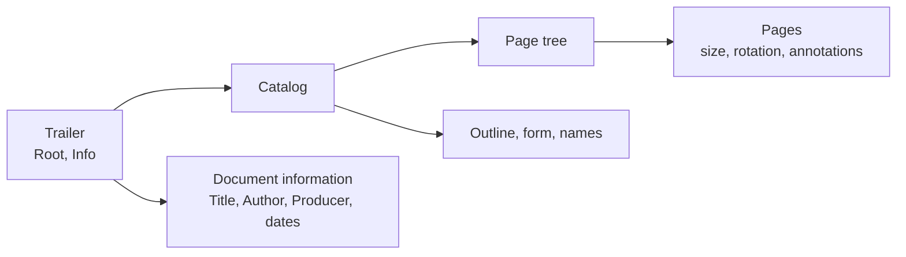

# REQ-PDF-004: Show the document and its pages

Status: Accepted

## Need

- The file structure (REQ-PDF-002) shows objects, not what they mean.
- Users want to see the document the objects make up: its catalog, its metadata, and its pages in reading order.
- Since PDF 1.5 most dictionaries sit in compressed object streams. The analyzer must open them to see anything.

## Requirement

- The analyzer follows `Root` to the catalog and shows its main entries: version, page layout and mode, language, and which optional parts are present.
- It follows `Info` and shows the document information entries as readable text.
- It walks the page tree in order and lists every page: its object, media box, crop box, rotation, and annotations. Inherited attributes count.
- It opens object streams, so compressed objects show their type and can be followed like any other object.
- It decodes the standard non-image filters, so stream contents it needs (object streams, scripts) can be read.
- A broken catalog, page tree, or object stream gives findings, not a crash. Loops end with a finding.
- Each rule cites the ISO 32000-1 clause it comes from.

## Rationale

- Page count, sizes, and metadata are the first questions about any PDF.
- A page tree that disagrees with its `Count`, or loops, is a common sign of a damaged or crafted file.
- Without object streams, most modern PDFs would show nothing beyond the trailer.

## Alternatives rejected

| Alternative | Why not |
|---|---|
| Render pages | Runs the content being inspected; out of scope (REQ-PDF-001) |
| Decode image filters (DCT, JPX, JBIG2, CCITT) | Only image data uses them; the document structure never does |
| Read every object up front | Slow on large files; the walk reads only the objects it reaches |

## Acceptance

- A three-page PDF lists three pages in order, with their media boxes; a media box set on the page tree root is inherited.
- A PDF 1.5 file whose catalog, pages, and annotations are all in an object stream shows the same pages.
- The `Title` of a UTF-16BE string and of a PDFDocEncoding string both show as readable text.
- A page tree whose `Kids` point back to an ancestor ends with `pdf.pages.loop`.
- A page tree whose `Count` disagrees with the pages found gives `pdf.pages.count`.

## Specified in

- [Streams and object streams](../../reference/pdf/streams.md), [Document](../../reference/pdf/document.md), [Report](../../reference/pdf/report.md)
