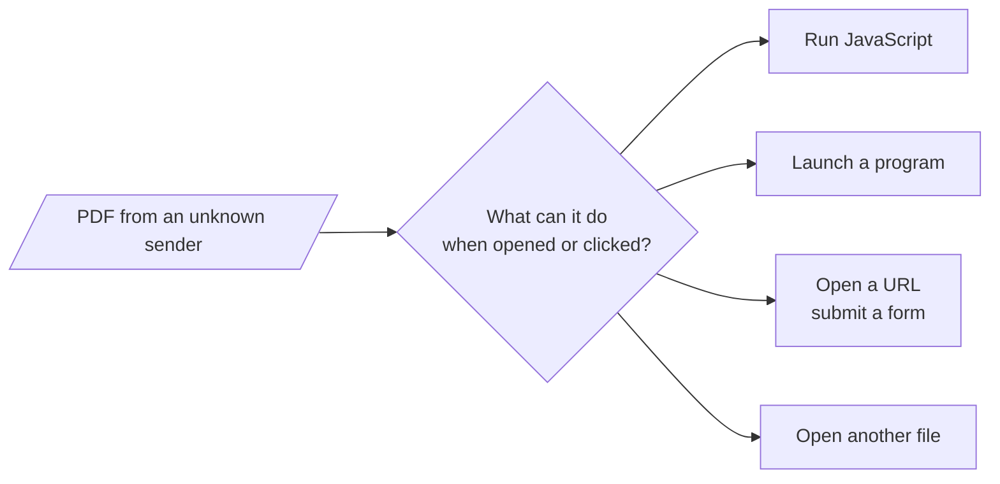

# REQ-PDF-005: Find the actions a PDF can perform

Status: Accepted

## Need

- Malicious PDFs act through actions: JavaScript, launching programs, sending form data, opening other files.
- Actions hide in many places: the open action, additional-actions dictionaries, annotations, form fields, outlines, the JavaScript name tree, and `Next` chains.
- Users want one list of every action, where it is, and when it runs, without opening the file in a reader.

## Requirement

- The analyzer finds actions in every place ISO 32000-1 defines for them, and follows `Next` chains.
- For each action it shows: the type, where it was found, what triggers it, the page when there is one, and the object that holds it.
- It shows each action's target: the URI, the file, the named action, or the destination.
- It shows JavaScript source as plain text. It never runs it.
- Actions that run without a click, when the document or a page opens, are marked.
- JavaScript, launch, submit-form, import-data, and remote go-to actions give findings.
- Each rule cites the ISO 32000-1 clause it comes from.

## Rationale

- These action types are how PDFs reach outside the reader: code execution, program launch, data sent to a server.
- Actions that run on open need no user mistake, so they matter most.
- Showing the script text lets users judge it themselves.

## Alternatives rejected

| Alternative | Why not |
|---|---|
| Scan the raw bytes for `/JavaScript` | Misses names written with `#xx` escapes and objects in compressed streams; finds text in unrelated places |
| Run or deobfuscate the JavaScript | Running hostile code is what the tool exists to avoid |
| Report only a yes/no "has JavaScript" | Users need to know where it is and when it runs |

## Acceptance

- An `OpenAction` with a JavaScript action lists one action marked as running on open, with its script text, and gives `pdf.action.javascript` and `pdf.action.automatic`.
- A link annotation with a URI action lists the URI, its page, and the annotation object.
- A JavaScript action in an object stream, with its script in a Flate-encoded stream, shows the decoded script.
- A `Next` chain that points back to an earlier action ends with `pdf.action.loop`.
- A PDF with only go-to links gives no action findings.

## Specified in

- [Actions](../../reference/pdf/actions.md), [Report](../../reference/pdf/report.md)
