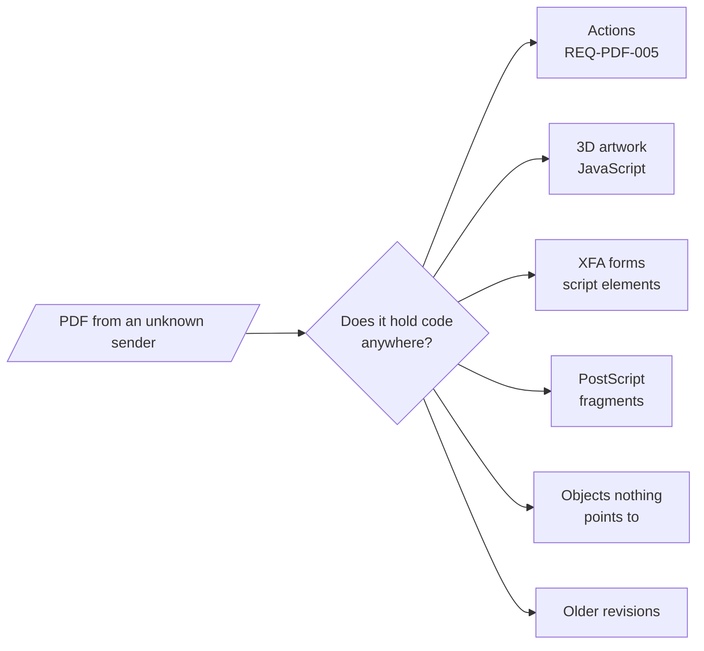

# REQ-PDF-006: Find scripts outside actions

Status: Accepted

## Need

- Actions are not the only place for code in a PDF. 3D artwork, XFA forms, and PostScript XObjects carry their own.
- Attackers hide code in objects that no visible place refers to, or remove it in an update while the bytes stay in the file.
- Users want to know whether a file holds code anywhere, not only in actions.

## Requirement

- The analyzer finds JavaScript in 3D streams that 3D annotations reach, and says when it runs.
- It finds script elements in XFA forms, with their language and the event that holds them, as written.
- It finds PostScript XObjects.
- It finds JavaScript in objects that no action place or 3D annotation reaches.
- It finds JavaScript that an older revision held and the newest revision no longer holds.
- It shows every script as plain text. It never runs it.
- Each kind gives a finding. Each rule cites the ISO 32000-1 clause it comes from, or says that it has none.

## Rationale

- An "it has no JavaScript actions" answer is wrong for a file with a 3D script or an XFA script.
- Malware analysts count `/JS` in every object for this reason. Reporting objects that nothing reaches catches code a walk would miss.
- Code removed by an incremental update is still in the file and still tells what the file was for.

## Alternatives rejected

| Alternative | Why not |
|---|---|
| Scan the raw bytes for `/JS` and `<script` | Misses names written with `#xx` escapes, compressed object streams, and Flate-encoded XFA |
| Parse XFA with an XML parser | `DOMParser` is not available in workers; a full in-house XML parser is large for listing scripts ([0012](../decisions/0012-pdf-find-scripts.md)) |
| Parse content streams for the `PS` operator | Needs a content stream parser; left for later |
| Run the scripts in a sandbox | Running hostile code is what the tool exists to avoid |

## Acceptance

- A 3D annotation whose 3D stream has an `OnInstantiate` script lists the script with its page, and says it runs when the page opens if the activation dictionary says `PO`.
- An XFA form with a `<script>` in an `initialize` event lists the script text, its `contentType`, and `initialize`.
- A PostScript XObject is listed with its PostScript text.
- A JavaScript action object that nothing refers to is listed as not reached.
- A JavaScript action removed by an incremental update is listed with the revision that held it.
- A file whose only JavaScript is in actions lists no other scripts.

## Specified in

- [Scripts](../../reference/pdf/scripts.md), [Report](../../reference/pdf/report.md)
