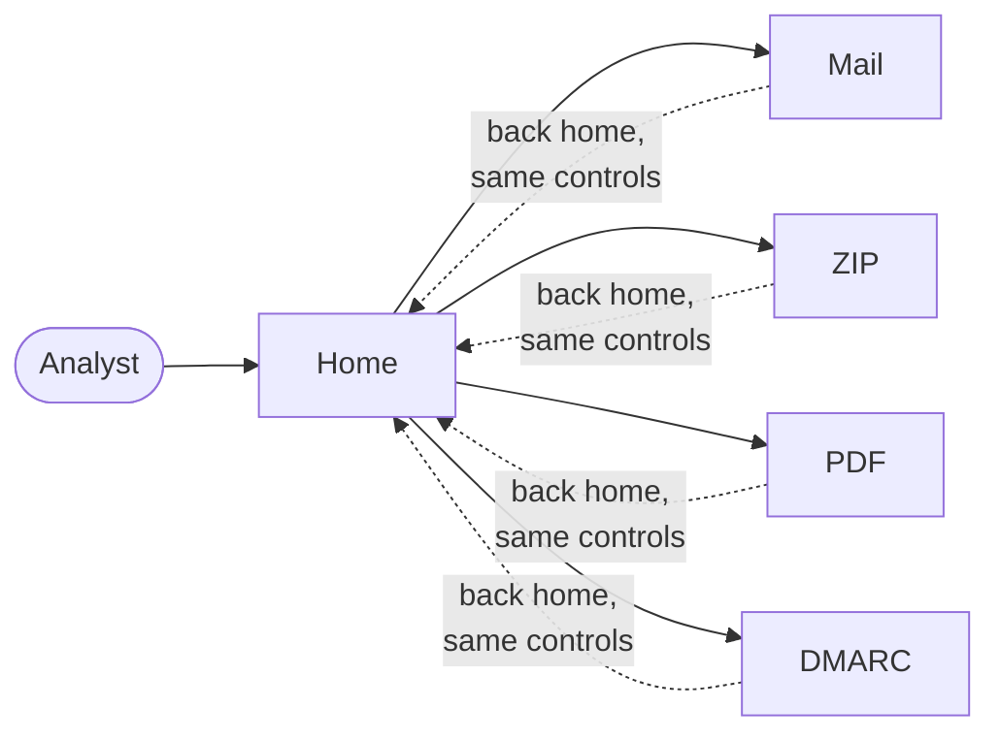

# REQ-SITE-001: One readable, accessible look across the tools

Status: Accepted

## Need

- Users often check one suspicious item with several tools: an email, then its ZIP attachment, then a PDF inside.
- Each tool looked different. Only one followed the system's dark mode, and no tool linked back home.
- Users decide whether to open a sensitive file by what the page promises about it. Only two pages said what leaves the browser.
- Keyboard and low-vision users need to reach every control and read every label.

## Requirement

- Every tool page must show the same header: a way home, the tool's name, and one line on what leaves the browser.
- That line must be true for the tool, including what its opt-in features send.
- All pages must follow the system's light or dark setting.
- Text must stay readable and controls visible in both settings, at WCAG 2.2 AA.
- Every control must be reachable and visibly focused with the keyboard.
- Tables must stay readable on a phone: words whole, and the page never scrolls sideways.
- Chart text must stay readable on a phone, not shrink with the chart.
- The look must not add any request to another host.

## Rationale

- A shared header and shared controls make the second tool as easy as the first.
- The privacy line puts the privacy model where the decision is made: next to the drop zone.

## Alternatives rejected

| Alternative | Why not |
|---|---|
| A CSS framework | A runtime dependency and a large stylesheet for a few parts |
| Web fonts for a brand look | A request to another host; blocked by the CSP |
| A shared navigation bar listing every tool | Grows with each tool; home already lists them |

## Acceptance

- Each tool page has a link home, one `h1`, and its privacy line from the spec.
- Theme color pairs meet the spec's contrast rules, checked by a test that reads `theme.css`.
- In a real browser, Tab reaches the DMARC file pickers and shows a focus ring.
- In a real browser at 390 px, a wide table keeps its words whole and scrolls in its own area, which Tab can reach; the page does not scroll sideways.
- In a real browser at 320 px, chart text and tooltips are drawn at 12 px or more and stay inside their chart.

## Specified in

- [Site-wide UI specification](../../reference/site/README.md)
- [UI design system](../ui-design-system.md), [0018](../decisions/0018-shared-look.md)
