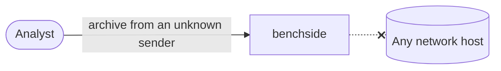

# REQ-ZIP-001: Analyze archives without sending them anywhere

Status: Accepted

## Need

- Users inspect archives they do not trust or may not share.
- Archives can be large; uploading them is slow as well as unsafe.

## Requirement

- The archive must never leave the browser tab.
- The ZIP analyzer makes no network requests at all.
- The browser must enforce this, not only our code.

## Rationale

- Unlike mail, nothing in a ZIP analysis needs outside data.
- A CSP of `connect-src 'none'` limits every script, including the worker.

## Alternatives rejected

| Alternative | Why not |
|---|---|
| Share the mail app's CSP | Allows DoH hosts the ZIP analyzer never needs |
| Server-side analysis | Requires uploading the archive |

## Acceptance

- The built ZIP app's `index.html` carries the CSP with `connect-src 'none'`.
- A browser test shows a worker started like the app's worker cannot reach another origin under that CSP.

## Specified in

- [ZIP analyzer specification](../../reference/zip/README.md)
- [Privacy model](../privacy-model.md), [0004](../decisions/0004-worker-from-blob-url.md)
