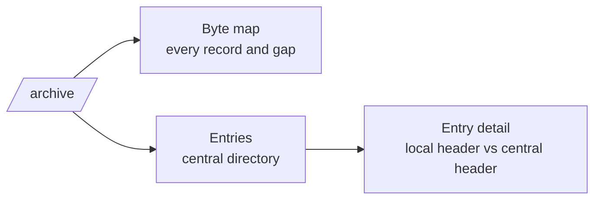

# REQ-ZIP-002: Show the archive's structure

Status: Accepted

## Need

- Users want to know what is in an archive without extracting it.
- They also want to see how it is built: which record sits where, and where two records disagree.
- Archive tools hide this. They pick one reading and show only names.

## Requirement

- The analyzer lists every entry from the central directory with its decoded fields.
- It shows a byte map: every record with its offset and length, and every byte range no record accounts for.
- For each entry, it shows the local header next to the central directory header and marks the fields that differ.
- It shows extra fields by ID and name, and decodes the ones it knows.
- Malformed structure produces findings, not a crash. The analyzer shows as much as it could read.
- Each rule cites the APPNOTE.TXT section it comes from.

## Rationale

- The central directory and the local headers are two copies of the same facts. Readers that trust different copies see different archives.
- A byte map makes prepended data (self-extracting stubs), gaps, and overlaps visible.
- Citing APPNOTE lets users check the rule themselves.

## Alternatives rejected

| Alternative | Why not |
|---|---|
| Scan the whole file for local headers | Slow on large files; the central directory is what readers use |
| List names only | Hides the facts users came for |

## Acceptance

- A ZIP built by a common tool lists every entry with name, method, sizes, CRC-32, time, and offset.
- An entry whose local header name differs from its central name shows a mismatch finding naming the field.
- An archive with bytes prepended shows them as a separate region and still lists its entries.
- A truncated archive shows the entries it could read and a finding saying where reading stopped.

## Specified in

- [Structure](../../reference/zip/structure.md), [Fields](../../reference/zip/fields.md), [Report](../../reference/zip/report.md)
