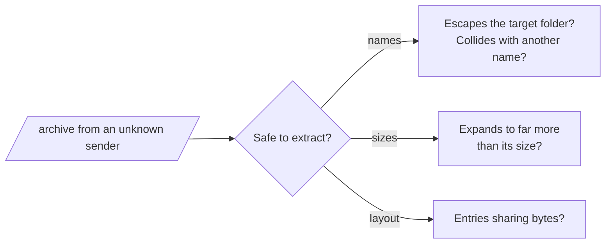

# REQ-ZIP-006: Warn about archives built to harm extraction

Status: Accepted

## Need

- Users receive archives they did not ask for.
- Before extracting, they want to know whether the archive is built to write outside the target folder, overwrite files, or exhaust the disk.

## Requirement

- The analyzer warns about entry names that escape the target folder: `..` components, absolute paths, drive letters, backslashes (APPNOTE 4.4.17.1).
- It warns about duplicate names, and about names that collide on the chosen target file system (case, reserved names, trailing dots or spaces).
- It warns about symlink entries, control or bidirectional characters in names, and over-long or over-deep paths.
- It warns about zip bombs: entries or archives whose compression ratio, total size, or entry count passes a threshold, and entries that share bytes.
- Each warning names the entry and the rule, and says which threshold it passed.
- The thresholds and the checks themselves can be adjusted ([REQ-ZIP-008](REQ-ZIP-008-parameters.md)).

## Rationale

- These are the attacks ZIP extractors have suffered from most: path traversal ("zip slip"), symlink tricks, name collisions, and decompression bombs.
- The analyzer already reads every name and size, so the checks need no extra reads.
- Thresholds differ by use: a log archive compresses far better than a photo archive.

## Alternatives rejected

| Alternative | Why not |
|---|---|
| Decompress every entry to measure real ratios | Slow on large archives; declared sizes are enough to warn, and nested opening already checks real sizes |
| Fixed thresholds | False alarms for some archives, missed bombs for others |

## Acceptance

- An entry named `../evil.sh` gives a path-traversal warning naming the entry.
- `a.txt` and `A.TXT` give a collision warning for Windows and macOS, not for Linux.
- An entry of 1 GiB declared from 1 MiB compressed gives a ratio warning at the default threshold, and none when the threshold is raised above 1 024.
- A plain archive from a common tool gives no warnings.

## Specified in

- [Security checks](../../reference/zip/security.md), [Parameters](../../reference/zip/parameters.md)
