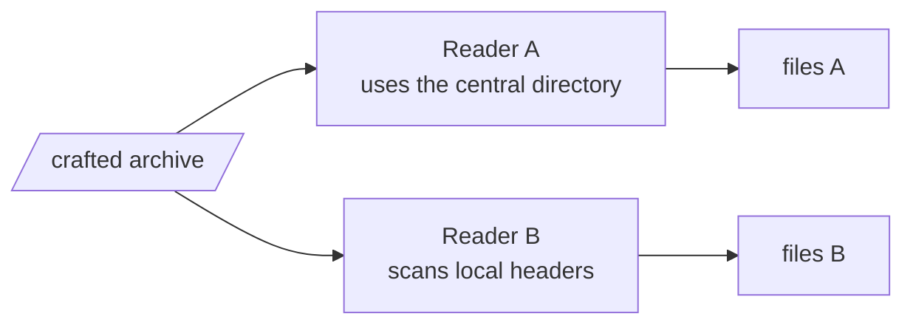

# REQ-ZIP-007: Show where ZIP readers would disagree

Status: Accepted

## Need

- A ZIP file can be built so that two readers list different files. A scanner reads one set; the user's extractor writes another.
- Analysts need to see every place where such a disagreement is possible.

## Requirement

- The analyzer reports every point where common readers could choose differently, including:
  - more than one end of central directory record candidate;
  - local and central headers that disagree on name, sizes, method, or the UTF-8 flag;
  - names that decode differently under the UTF-8 flag, the Unicode Path extra field, and Code Page 437;
  - bytes outside the central directory's view that look like local headers.
- Each finding says which readings exist and which one the analyzer used.

## Rationale

- Disagreement between readers is how malware has slipped past mail and endpoint scanners.
- The analyzer already compares local and central headers ([REQ-ZIP-002](REQ-ZIP-002-show-structure.md)). This requirement frames those differences as a risk and adds the cases it does not yet cover.

## Alternatives rejected

| Alternative | Why not |
|---|---|
| Emulate specific readers (Info-ZIP, 7-Zip, Windows) | Their behavior changes between versions; listing the choice points is stable |

## Acceptance

- An archive with a second EOCD inside its comment reports both candidates and which one was used.
- An entry whose local name differs from its central name is reported as a reader disagreement, naming both names.

## Specified in

- [Reader disagreement](../../reference/zip/disagreement.md)
