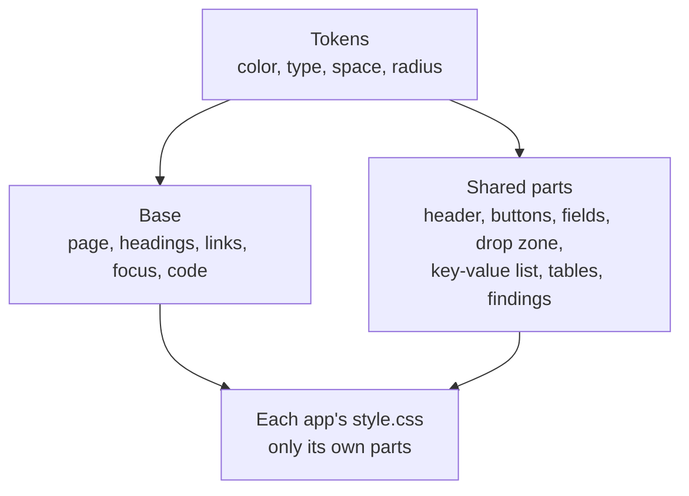

# UI design system

The shared look of every benchside app. It lives in `@benchside/ui`: `theme.css` and `AppHeader`. Why: [0018](decisions/0018-shared-look.md).



## Tokens

### Color

Contrast is against `--surface` in the same theme.

| Token | Light | Dark | Use | Contrast |
|---|---|---|---|---|
| `--surface` | `#fcfcfb` | `#1a1a19` | Page | — |
| `--surface-raised` | `#ffffff` | `#232322` | Cards, buttons, fields | — |
| `--surface-sunken` | `#f1f1ee` | `#141413` | Code blocks, active drop zone | — |
| `--ink` | `#0b0b0b` | `#f0efec` | Text | 19.2, 15.2 |
| `--muted` | `#5c5c58` | `#a8a8a3` | Labels, notes | 6.5, 7.3 |
| `--line` | `#d8d8d4` | `#3a3a37` | Dividers | decorative |
| `--border` | `#8a8a85` | `#6e6e69` | Control edges | 3.4, 3.4 |
| `--accent` | `#1d5fb0` | `#7db3f2` | Links, focus ring, active drop zone | 6.2, 8.0 |
| `--good`, `--warning`, `--critical` | `#0ca30c`, `#fab219`, `#d03b3b` | same | Borders and marks beside words | — |
| `--good-ink`, `--warning-ink`, `--critical-ink` | `#0a7d0a`, `#9a6700`, `#b42d2d` | `#4cc94c`, `#fab219`, `#f07a7a` | Status words and icons | 4.7 or more |

- Text tokens reach 4.5:1 (WCAG 1.4.3). Control borders reach 3:1 (WCAG 1.4.11).
- Status color never carries meaning alone. A word ("Warning", "differs", "Trusted") sits beside it.
- Chart colors are not here. They belong to the app that draws the chart (DMARC: [UI design](dmarc-aggregate-design/ui.md#color)).

### Type, space, shape

| Token | Value | Use |
|---|---|---|
| `--font` | `system-ui, sans-serif` | All text. No web fonts: they would be a request to another host |
| `--mono` | `ui-monospace, …` | Code, hex, header values |
| `--text-s`, base, `--text-l`, `--text-xl` | 0.875, 1, 1.25, 1.75 rem | Labels and table heads; body; h2; h1 |
| `--space-1` … `--space-6` | 0.25, 0.5, 0.75, 1, 1.5, 2 rem | All margins and padding |
| `--radius-s`, `--radius-m` | 0.25, 0.5 rem | Controls; panels |
| `--page` | 72 rem | Widest content |

## Shared parts

| Part | Markup | States |
|---|---|---|
| App header | `AppHeader title privacy` | — |
| Button | `<button>`, or `.button` on a label that wraps a file input | hover: ink border; focus: accent ring (on the label while its input has focus); disabled: half opacity |
| Link-like button | `button.link` | as a link |
| Field | `select`, `input[type=number]`, `input[type=text]` | focus: accent ring |
| Check box, radio | native, `accent-color` | — |
| Group | `fieldset` + `legend` | — |
| Drop zone | `.drop` (`DropZone`, DMARC `Input`) | `data-active="true"`: accent border, sunken fill |
| Key-value list | `dl` with `dt`, `dd` pairs | two columns: label, value |
| Table | `TableScroll label` around a `table`; numbers use tabular figures; column heads small, row heads at body size; `td.long` for a one-token cell; `.nowrap` for dates and times | the area scrolls sideways when the table is wider than the page (SITE-9); a soft shadow marks each edge with more to scroll |
| Finding | `.finding[data-severity]` | error: critical border; warning: warning border |
| Note | `.note` | muted text |
| Error | `.error` | critical ink |

- Buttons and fields are at least 24 px tall. Link-like buttons in table rows and check boxes inside their label use the WCAG 2.5.8 exceptions (SITE-7).
- Focus shows a 2 px accent ring outside the element.
- Motion: a transition sits inside `@media (prefers-reduced-motion: no-preference)`, so it never runs for users who turned motion off.

## App header

```text
benchside                 ← link to home, small, muted
ZIP analyzer              ← the page's only h1
Your file stays …         ← privacy line, muted
[extra lines]             ← optional, after the privacy line
```

| App | Privacy line |
|---|---|
| Mail | Your message stays in this browser. Only DNS lookups of domain names go out, over DNS-over-HTTPS. |
| ZIP, PDF | Your file stays in this browser. This page cannot connect anywhere. |
| DMARC aggregate | Your files never leave this browser. If you turn on host-name lookup, source IP addresses go to the DNS provider you pick. |

Each line states what leaves the browser, opt-in features included ([privacy model](privacy-model.md), SITE-2).

## Home

- One card per tool: the name as the link, one sentence on what it does.
- The tool's name is the link; the sentence stays plain, selectable text.
- Home has no script; it links `theme.css` from its HTML.

## Rules for app stylesheets

| Do | Don't |
|---|---|
| Use tokens: `var(--muted)`, `var(--space-3)` | Hard-code a hex value or a spacing number |
| Add a part to `theme.css` once a second app needs it | Copy a rule from another app |
| Use classes and data attributes | Use `style` attributes (blocked by the CSP) |
| Mix a status color into a background with `color-mix()` | Pick a new tint per app |
