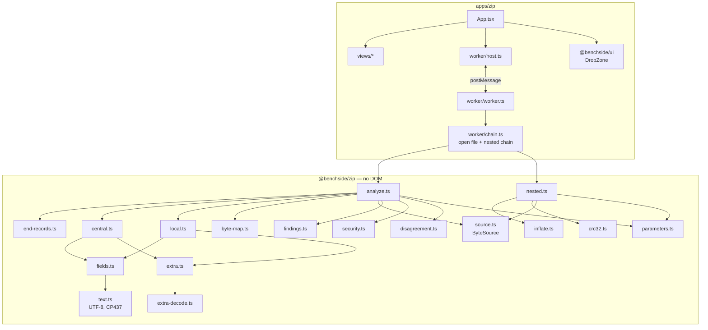
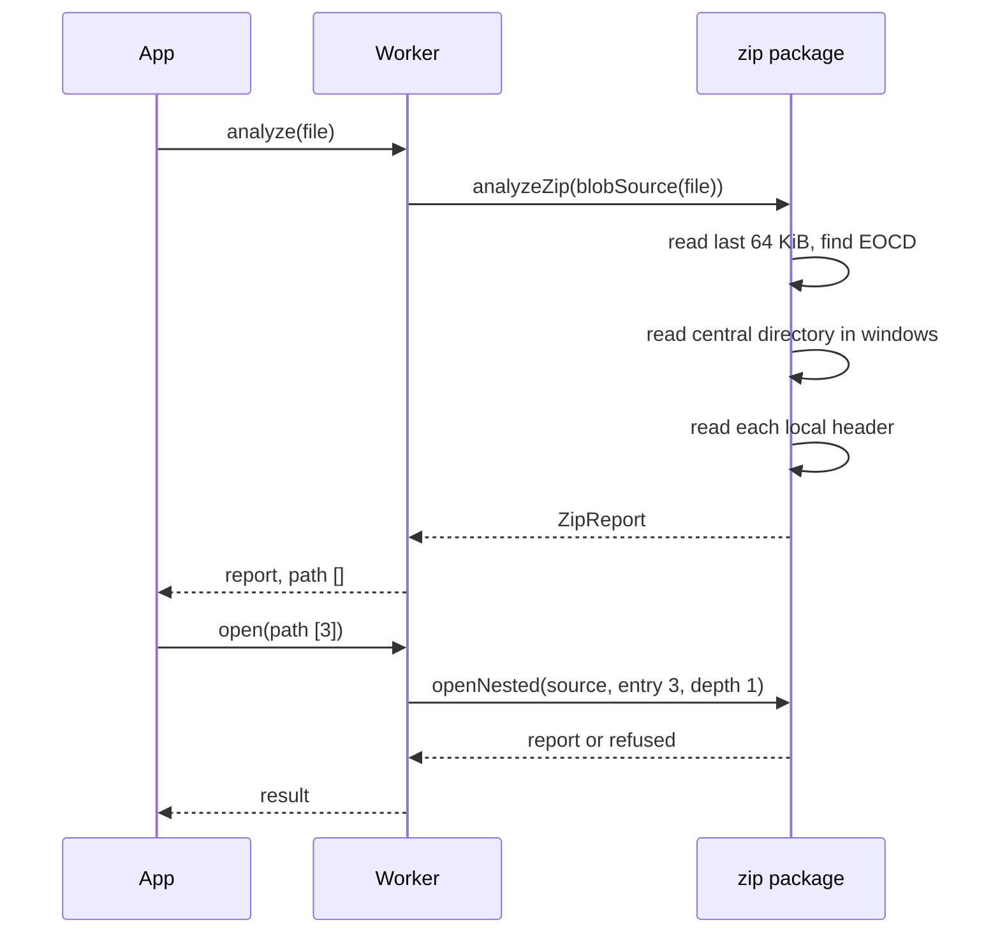
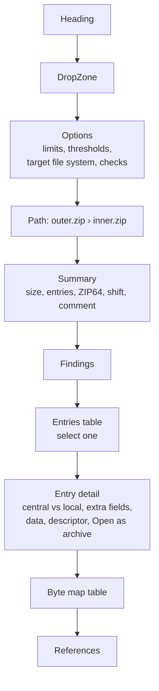
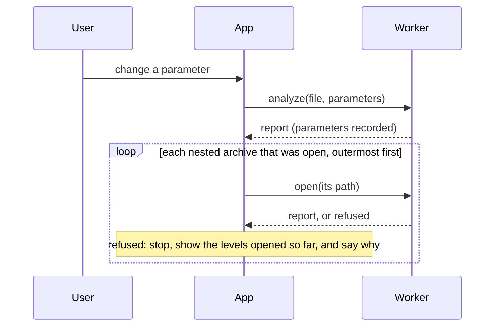

# ZIP analyzer architecture

Spec: [ZIP analyzer specification](../reference/zip/README.md). Decision: [0007](decisions/0007-zip-read-from-the-end.md).

## Modules

| Module | Does | Rules |
|---|---|---|
| `source.ts` | `ByteSource`, `blobSource`, `bytesSource`, cached window reader | — |
| `end-records.ts` | EOCD search, ZIP64 locator and record, effective values | EOCD-*, Z64-1..4, NUM-1 |
| `central.ts` | Central directory location, shift, headers | CD-* , Z64-5, Z64-7 |
| `local.ts` | Local headers, comparison, file data, descriptors | LH-*, Z64-6 |
| `byte-map.ts` | Regions, gaps, overlaps | MAP-* |
| `fields.ts` | Versions, flags, methods, DOS time, attributes | FLD-* |
| `extra.ts` | Extra field blocks, names, ZIP64 and Unicode Path decoding | EXT-1..4, EXT-10, NAME-2 |
| `extra-decode.ts` | Timestamps, UNIX owner, NTFS times, AES, Android alignment | EXT-5..9, EXT-11 |
| `text.ts` | UTF-8 and Code Page 437 decoding | NAME-1, NAME-3, NAME-4 |
| `crc32.ts` | CRC-32 | EXT-4 |
| `inflate.ts` | Bounded raw-deflate decompression | NEST-3 |
| `nested.ts` | Refusal reasons, content, verification | NEST-* |
| `findings.ts` | Finding collector with the 1 000 limit; severity, category, and section per ID | REP-7, REP-8, REP-10 |
| `parameters.ts` | Defaults, ranges, clamping | PAR-* |
| `security.ts` | Name, size, count, and overlap checks over the finished entries and byte map | SEC-* |
| `disagreement.ts` | EOCD candidates, name encodings, bounded scan of gaps for hidden headers | RD-1, RD-3..5 |

## Analysis flow

## Worker protocol

| Direction | Message |
|---|---|
| UI → worker | `{ type: 'analyze', id, file: Blob, parameters }` |
| UI → worker | `{ type: 'open', id, path: number[] }` |
| worker → UI | `{ type: 'report', id, report }` |
| worker → UI | `{ type: 'refused', id, reason }` |
| worker → UI | `{ type: 'failed', id, message }` |

- A `File` is passed by reference; it is not copied into memory.
- The host keeps only the latest request's answer, like the mail app's host. A worker error rejects the waiting request.
- `parameters` is the user's partial set; the package fills in defaults and clamps (PAR-11). Nested archives reuse the top-level report's values (PAR-13), so `open` carries none.
- `ArchiveChain` (`worker/chain.ts`) caches `{ source, report }` per path. Opening a path drops cached entries that are not on it, and only the latest open fills the cache. A new file drops them all.

## UI

| Rule | Why |
|---|---|
| Tables show 500 rows, then a "Show more" button | 100 000 entries would make the page slow; paging is simpler than virtual scrolling and keeps keyboard order |
| Mismatched fields carry the text "differs", not only a color | Distinctions must not rely on color alone |
| Offsets show decimal and hex | APPNOTE and hex editors use hex; sizes are easier in decimal |
| Findings show their APPNOTE section | REQ-ZIP-002: users can check the rule |
| Names and comments render as text | They come from the file |
| "Open as archive" shows the refusal reason inline | The user sees why nothing opened |
| The archive hint reads "archive?" next to the name | Marks likely archives without color |
| Findings are grouped under Security, Reader disagreement, and Structure, each with a count | The category answers "should I worry?" before the details |
| Options live in component state only | REQ-ZIP-008: values last for the visit; nothing is stored |
| A number input applies on change (blur or Enter), not on every keystroke | Typing "1000" must not analyze with 1, 10, and 100 first |

## Shared UI

The drop zone moves from the mail app into `@benchside/ui` (the second app needs it). It keeps the class `drop` and its layout rule ([mail UI](mail-design/ui.md)).

## Changing an option

A change re-reads the headers and decompresses the open nested archives again, even when only a security check was toggled. That keeps one code path and always matches the spec. If it proves slow on very large archives, the security checks can run again on the cached report instead.
