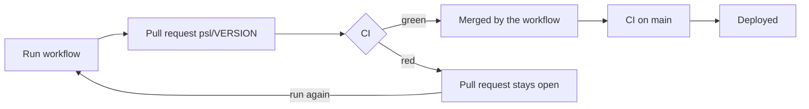

# How to update the Public Suffix List snapshot

The mail analyzer bundles a snapshot of the [Public Suffix List](https://publicsuffix.org/) for DMARC under RFC 7489 ([0003](../explanation/decisions/0003-bundle-public-suffix-list.md)). A workflow proposes updates as pull requests.

## Prerequisites

- Write access to the repository.
- One-time setting: **Settings → Actions → General → Workflow permissions → Allow GitHub Actions to create and approve pull requests**. Without it the workflow pushes its branch but cannot open the pull request.
- No branch protection rule on `main` that requires a review. With one, the workflow cannot merge, and you merge by hand (step 4).

## Steps

1. The workflow `Update Public Suffix List` (`.github/workflows/psl.yml`) runs every Monday. To run it now: **Actions → Update Public Suffix List → Run workflow**.
2. If the list changed, it opens a pull request from the branch `psl/<VERSION>`. If nothing changed, it stops without one.
3. It waits for CI on that commit. When CI passes, it merges the pull request and starts CI on `main`, which deploys. Nothing to do ([0019](../explanation/decisions/0019-merge-psl-updates-automatically.md)).
4. If CI fails, is cancelled, or takes more than 45 minutes, the run fails and the pull request stays open. Run the workflow again to retry: it rebuilds the branch on the current `main` and waits for CI again. To give up on that `VERSION`, close the pull request.

## Result

- `packages/mail/data/public_suffix_list.dat` is the new upstream file.
- RFC 7489 results show the new `VERSION` next to the organizational domain.

## If the pull request was not opened

The run log says so, and the branch `psl/<VERSION>` exists. Turn on the setting above and run the workflow again: it rebuilds the branch on the current `main` and opens the pull request. Or open the pull request from that branch by hand and use **Update branch** first. A pull request opened by hand is not merged automatically.
