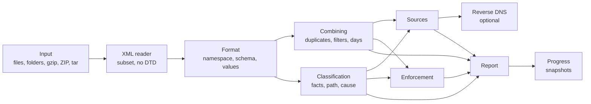

# DMARC aggregate report analyzer specification

Exact behavior of `@benchside/dmarc-aggregate` and of the reverse lookup in the DMARC aggregate app. Why each feature exists: [requirements](../../explanation/requirements/) (REQ-DMARC-*).

Each rule has an ID (for example `FMT-2`). Test scenarios cite these IDs.

## Scope

Aggregate reports only. RFC 7489 defined both report types in one document; DMARCbis split them into separate RFCs.

| Report type | DMARCbis | Earlier | Requested by | This analyzer |
|---|---|---|---|---|
| Aggregate report: XML, counts per source | RFC 9990 | RFC 7489 §7.2, Appendix C | `rua` | Read |
| Failure report: one message per failure | RFC 9991 | RFC 7489 §7.3 | `ruf` | Not read |

A failure report is a mail message, not XML, so INP-3 rejects it as `aggregate.input.unknown-type`.

Sources:

- RFC 9990, DMARC Aggregate Reporting (DMARCbis). Sections such as "§3.1.1.9" refer to it unless another RFC is named.
- RFC 7489, DMARC, §7.2 and Appendix C (the earlier aggregate report schema). Its failure reports (§7.3) are out of scope.
- RFC 9989, DMARC (DMARCbis core), for pass and fail, policies, and interoperability.
- RFC 8601 §3 (iprev), RFC 1035 §3.5, RFC 3596 §2.5, and RFC 5952 §4 for reverse lookup and address text.

## Pages

| Page | Covers |
|---|---|
| [Input](input.md) | Files and folders, kinds (XML, gzip, ZIP, tar), nesting, labels, file names |
| [XML reader](xml.md) | The XML subset read, encodings, namespaces, refusals, several documents in one input |
| [Format](format.md) | Namespaces and formats, the element table for both schemas, values, content hints |
| [Combining reports](combine.md) | Report identity, duplicates, overlaps, filters, days, totals, policies |
| [Classification](classify.md) | Record facts, delivery path, cause of failure |
| [Enforcement](enforcement.md) | Policy in effect, what `quarantine` and `reject` would change, status |
| [Sources](sources.md) | The per-IP table and its detail rows |
| [Reverse DNS](reverse-dns.md) | Optional PTR lookup and forward confirmation |
| [Progress](progress.md) | Snapshots while reading, stop, lookup progress |
| [Report](report.md) | Output data model and findings |

## Conventions

| Term | Meaning |
|---|---|
| File | One dropped file. A ZIP file can hold several reports |
| Report | One `feedback` document (§3.1.1.1) |
| Record | One `record` element: a source IP, a count, and its results (§3.1.1.7) |
| Batch | Every report loaded since the last "Clear" |
| Filtered set | The records that pass the current filters (CMB-6) |
| Reporter | The `org_name` of a report (§3.1.1.3) |
| Policy domain | `policy_published/domain` (§3.1.1.5) |
| Author domain | `identifiers/header_from` (§3.1.1.10) |
| Raw result | A result in `auth_results`, "uninterpreted with respect to DMARC" (§3.1.1.11) |
| Aligned result | A result in `policy_evaluated`: the DMARC alignment test (§3.1.1.9) |
| Messages | The sum of `count` over records |
| Finding | A diagnostic with ID, severity, message, and location ([Report](report.md#findings)) |

## Limits

These are this analyzer's limits, not the RFCs'.

| Limit | Value | When exceeded |
|---|---|---|
| Files per batch | 20 000 | `aggregate.input.too-many-files`; later files are not read |
| File size | 64 MiB | `aggregate.input.too-large`; the file is not read |
| Decompressed XML per report | 32 MiB | `aggregate.input.too-large`; the report is not read |
| Decompressed bytes per batch | 1 GiB | `aggregate.input.budget`; later files are not read |
| Entries per ZIP file | 1 000 | `aggregate.zip.too-many-entries`; later entries are not read |
| Entries per tar archive | 10 000 | `aggregate.tar.too-many-entries`; later entries are not read |
| XML nesting depth | 32 | `aggregate.xml.malformed`; the report is not read |
| Text kept per element | 4 096 characters | The text is cut and marked truncated (FMT-11) |
| Timeline days | 1 000, the latest | Earlier days are summed into one number (CMB-10) |
| Records per batch | 1 000 000 | `aggregate.too-many-records`; later records are not read |
| DKIM results per record | 100 (the §3.1.3 upper bound) | `aggregate.record.too-many-dkim`; the rest are ignored |
| Lookup targets | The first 200 rows of the source table as shown | The rest show "not looked up" (RDNS-2) |
| Names checked forward per IP | 3 | The rest are not checked (RDNS-4) |
| DNS queries per lookup session | 2 000 | `dns.budget-exhausted` (RDNS-6) |
| Findings per batch | 10 000 | `aggregate.too-many-findings`; later findings are dropped |
