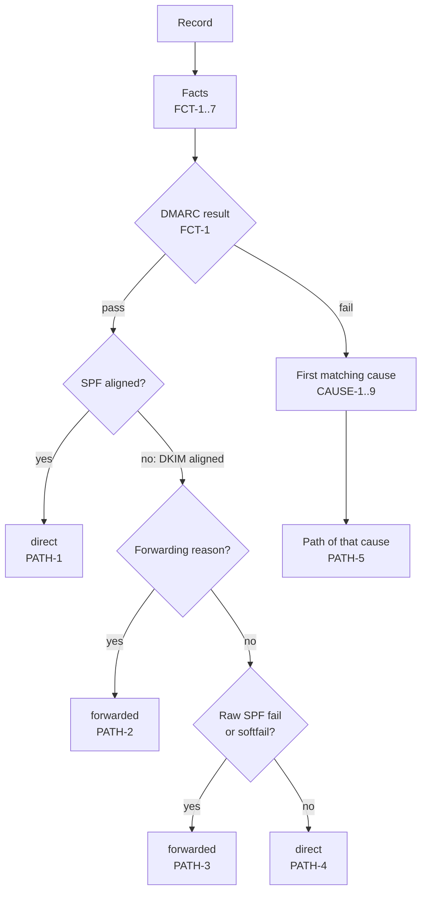

# Classification

How each record gets a delivery path and, when DMARC fails, a cause. These are estimates from report data alone. Why this approach: [0016](../../explanation/decisions/0016-dmarc-aggregate-classify.md).

## Facts

| ID | Rule |
|---|---|
| FCT-1 | DMARC result: `pass` when `policy_evaluated/dkim` or `policy_evaluated/spf` is `pass`, else `fail` (RFC 9989 §5.3.5). These two elements are the alignment results (§3.1.1.9), as the reporter evaluated them. benchside does not evaluate alignment again. |
| FCT-2 | A domain is related to a record when it equals the author domain or the policy domain, or is a subdomain or parent of either, comparing whole labels. Example: `mail.example.com` and `example.com` are related; `example.net` is not. This stands in for relaxed alignment without an organizational domain lookup (RFC 9989 §4.10.2). It can call a public suffix related. |
| FCT-3 | DKIM facts, from `auth_results/dkim`: aligned (`policy_evaluated/dkim` is `pass`); related pass (a result `pass` from a related domain); related fail (a result `fail` from a related domain); other pass (a result `pass` from an unrelated domain); temperror; permerror; none (no DKIM results, or all are `none`). |
| FCT-4 | SPF facts, from the SPF result chosen by FMT-9: aligned (`policy_evaluated/spf` is `pass`); the raw result, or absent; and whether its domain is related. An empty domain (null reverse-path) is unrelated. |
| FCT-5 | Forwarding reason: an override type `forwarded`, `trusted_forwarder`, or `mailing_list` (§3.1.6; RFC 7489 Appendix C). |
| FCT-6 | An aligned `pass` without a raw `pass` of that method in `auth_results` gives `aggregate.record.inconsistent` (info), once per record, naming each such method. It is checked when the report is counted. Classification still uses the aligned result. |
| FCT-7 | A forwarder IP is a source IP with at least one record classified by PATH-2 or PATH-3 anywhere in the counted reports. The fact is given only for DMARC-failing records, the only ones that use it (CAUSE-3). All counted reports are used, not the filtered set, so a filter never changes a classification. |

## Delivery path

`direct`: the source sent the mail itself. `forwarded`: the mail passed through a forwarder or a mailing list on the way. `other`: nothing in the record shows a legitimate route.

| ID | Rule |
|---|---|
| PATH-1 | DMARC `pass` and SPF aligned: `direct`. The source is authorized by the author domain's SPF. |
| PATH-2 | DMARC `pass`, not SPF aligned, and a forwarding reason: `forwarded`. The receiver says so. |
| PATH-3 | DMARC `pass`, not SPF aligned, and a raw SPF result of `fail` or `softfail`: `forwarded`. DKIM survived while SPF broke at an intermediary, as RFC 9989 §7.4 describes for relayed mail. |
| PATH-4 | Any other DMARC `pass`: `direct`. Typical case: a service that signs with the author domain and uses its own envelope sender. |
| PATH-5 | DMARC `fail`: the path of the first matching cause below. |

Rules are tried in order; the first match wins. Each record reports the rule ID that matched.

## Cause of failure

Only DMARC-failing records get a cause. The first matching rule is the cause; every other rule that also matches is listed with it.

| ID | Cause | Condition | Path | Label |
|---|---|---|---|---|
| CAUSE-1 | `reported-forwarding` | A forwarding reason (FCT-5) | `forwarded` | The receiver reports forwarding or a mailing list |
| CAUSE-2 | `dkim-broken` | DKIM related fail | `forwarded` | A DKIM signature of the domain did not verify. The message was likely changed on the way |
| CAUSE-3 | `spf-broken-by-forwarding` | The source is a forwarder IP (FCT-7) | `forwarded` | Sent through a known forwarder: SPF broke, and no DKIM signature survived |
| CAUSE-4 | `spf-not-aligned` | Raw SPF `pass` | `direct` | SPF passes, but for a domain that does not align, such as a service's own envelope sender |
| CAUSE-5 | `dkim-not-aligned` | DKIM related pass or other pass | `direct` | DKIM passes, but only for a domain that does not align |
| CAUSE-6 | `temporary-error` | SPF or any DKIM result `temperror` | `other` | Unknown: a temporary DNS error |
| CAUSE-7 | `permanent-error` | SPF or any DKIM result `permerror` | `other` | Unknown: a broken SPF record or DKIM key |
| CAUSE-8 | `no-dkim` | DKIM none | `other` | No DKIM signature, and SPF does not pass: spoofed, or forwarded unsigned mail |
| CAUSE-9 | `unauthenticated` | Always | `other` | Nothing authenticates: likely spoofed |

| Path | Causes, as grouped in the UI |
|---|---|
| `forwarded` | CAUSE-1, CAUSE-2, CAUSE-3 |
| `direct` | CAUSE-4, CAUSE-5: fix these before enforcement (RFC 9989 §5.1.6) |
| `other`, unknown | CAUSE-6, CAUSE-7 |
| `other`, likely spoofed | CAUSE-8, CAUSE-9 |

| ID | Rule |
|---|---|
| CAUSE-10 | Each classified record reports: path, the PATH rule, the cause and its CAUSE rule, the other matching causes, and the facts used (FCT-1 to FCT-7). |
| CAUSE-11 | Host names from reverse lookup are never used (REQ-DMARC-005). |

## Known limits

These cases get the wrong class by design. The UI shows the facts so users can catch them.

| Case | Classified as | Actual route |
|---|---|---|
| A forwarder that rewrites the envelope sender (SRS): DKIM pass, SPF pass for the forwarder's domain | `direct` (PATH-4) | Forwarded |
| A service that signs with the author domain, but sends with the author domain as envelope sender and is not in its SPF record | `forwarded` (PATH-3) | Direct, with an SPF gap |
| A spoofer whose own domain's SPF passes | `direct`, `spf-not-aligned` (CAUSE-4) | Abuse. The SPF domain is shown |
| A forwarder that carried no signed mail in the batch | `other` (CAUSE-8) | Forwarded |
| A DKIM domain that is a public suffix (FCT-2) | Related | Unrelated |
