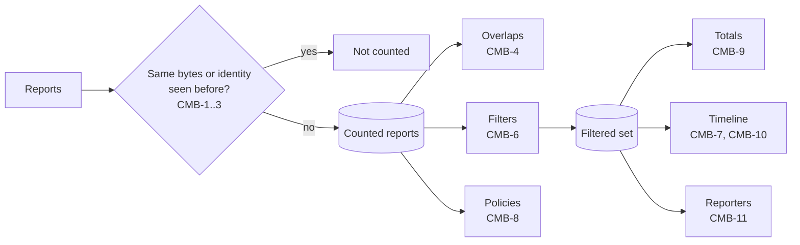

# Combining reports

How the reports of a batch become one data set, and the totals, series, and lists computed from it. Per-record classification: [Classification](classify.md).

## Identity and duplicates

| ID | Rule |
|---|---|
| CMB-1 | A report's identity is the reporter (`org_name`, case-insensitive), the `report_id`, and the policy domain. The Report-ID is unique "among reports to the same domain" (§3.5.1). A report without `report_id` has no identity: it is counted unless CMB-2 finds a byte-identical copy, and CMB-3 never applies to it. |
| CMB-2 | A report whose decompressed XML bytes are identical (SHA-256) to those of a counted report gives `aggregate.report.duplicate` (info) and is not counted (§3.5.4). This holds with or without an identity, so the same file dropped twice counts once. |
| CMB-3 | A report whose identity was already counted but whose bytes differ gives `aggregate.report.conflict` (warning) and is not counted. The report loaded first stays. §3.5.2 requires a resent report to keep its original name, so a differing copy is unexpected. |
| CMB-4 | Two counted reports from the same reporter for the same policy domain whose ranges overlap (`begin` < other `end` and other `begin` < `end`) give `aggregate.report.overlap` (warning). Both stay counted. §3.1.1.4: periods "SHOULD NOT overlap"; §3.5.4 leaves the choice to the receiver. |
| CMB-5 | Reporters are grouped case-insensitively by `org_name`. The spelling shown is the first one loaded. |

## Filters

| ID | Rule |
|---|---|
| CMB-6 | Three filters select the filtered set: policy domain (all, or one), reporter (all, or a subset), and UTC days (all, or a range of days by CMB-7). A record is in the filtered set when its report passes the domain and reporter filters and its report's day is in the range. Undated reports pass the day filter only when it is "all". Every total, series, list, chart, and table below uses the filtered set, except CMB-8 and FCT-7. |

## Days

| ID | Rule |
|---|---|
| CMB-7 | A report's day is the UTC calendar day that contains the midpoint of `begin` and `end`. §3.1.1.4: a period typically covers "a single UTC day, beginning at 0000UTC", but this is not required. A report without both values, or with `end` before `begin` (`aggregate.value.invalid`), is undated. A report spanning more than 48 hours gives `aggregate.report.long-range` (info) and still uses its midpoint. A report whose `end` is more than 2 days after the time the worker reads it gives `aggregate.report.future` (warning) and is undated, so one report from a wrong clock cannot stretch the timeline. The time of reading is an input to the analysis, so tests can fix it. |

## Policies

| ID | Rule |
|---|---|
| CMB-8 | For each policy domain, the distinct `policy_published` configurations in the counted reports are listed: `p`, `sp`, `np`, `adkim`, `aspf`, `pct`, `fo`, `testing`, `discovery_method`, each as stated or "not stated". Each configuration shows its reporters and its first and last day. A domain with more than one configuration gives `aggregate.policy.changed` (info) (§3.3). The configuration "in effect" is the one with the latest day; ties go to the one seen by more reports, then to the one loaded first. |

## Totals and series

| ID | Rule |
|---|---|
| CMB-9 | Totals over the filtered set: messages; DMARC-passing and DMARC-failing messages (FCT-1); messages by disposition; by delivery path; by cause; reports; reporters; distinct source IPs; distinct author domains; and the period, from the earliest `begin` to the latest `end`. The DMARC pass rate is passing messages divided by messages; it is not shown when there are no messages. |
| CMB-10 | Timeline: for each UTC day from the first to the last day of the filtered set, messages by delivery path and the DMARC pass rate. Days with no reports are present with no value, not zero. Messages of undated reports are given as one separate number. At most the latest 1 000 days are listed; messages of earlier days are given as one more separate number. |
| CMB-11 | Reporters: for each reporter in the filtered set, reports, messages, DMARC-passing messages, pass rate, the days covered, and the declared formats of its reports. Sorted by messages, most first. |
| CMB-12 | Formats: the reports in the filtered set by declared format and by namespace URI as written (FMT-2), and the number with `aggregate.format.mixed`. |
| CMB-13 | Reporter errors: each `report_metadata/error` text, with its reporter, policy domain, and day (§3.1.5). Each also gives `aggregate.report.error` (info). |
