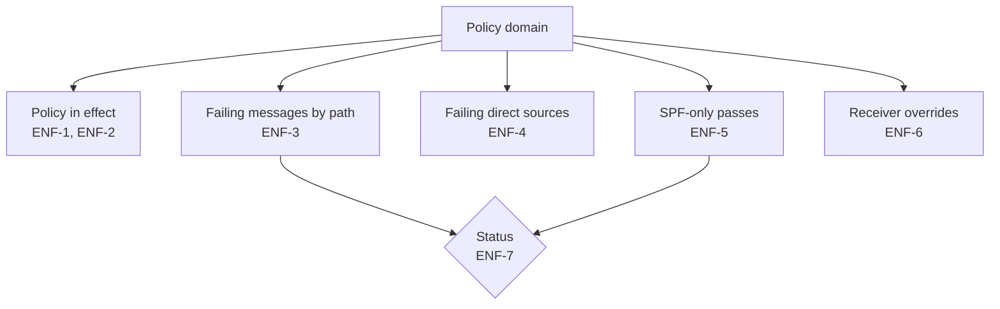

# Enforcement

What the filtered set says about moving a policy domain to `quarantine` or `reject`. Inputs: [Combining reports](combine.md) and [Classification](classify.md).

| ID | Rule |
|---|---|
| ENF-1 | Each policy domain in the filtered set shows the configuration in effect (CMB-8): `p`, `sp`, `np`, `testing`, and `pct`, each as stated or "not stated". |
| ENF-2 | Records whose author domain equals the policy domain fall under `p`. Other records fall under `sp`, or `p` when `sp` is not stated (RFC 9989 §4.7). Reports cannot tell whether an author domain exists, so `np` is shown but never applied. |
| ENF-3 | Failing messages by delivery path, each with its share of that path's messages, split into two parts: already quarantined or rejected (disposition `quarantine` or `reject`), and not yet acted on (disposition `none` or `pass`). Under enforcement, a receiver that follows the policy would quarantine or reject all of them (RFC 9989 §5.3.6). |
| ENF-4 | Failing direct sources: each source IP with failing messages on the `direct` path, with those messages, its most common cause among them (ties as in SRC-2), and its SPF and DKIM domains. Sorted by failing messages, most first. RFC 9989 §5.1.6: legitimate unaligned streams "MUST be addressed" before enforcement. |
| ENF-5 | SPF-only passes: passing messages that are SPF aligned but not DKIM aligned, with their share of passing messages and their sources. RFC 9989 §7.4: a domain that publishes `p=reject` "MUST NOT rely solely on SPF". |
| ENF-6 | Receiver overrides: failing messages whose disposition is weaker than the policy of their own report under ENF-2, grouped by override type, or "no reason"; a record with several types counts in each. A policy that is not stated counts as `none`. A weaker disposition without a reason gives `aggregate.record.no-reason` (info); §3.1.1.9 says the reason "MUST be included". The finding is raised once per record, when its report is counted, whatever the filters. The order from weak to strong is `none` = `pass`, `quarantine`, `reject`. |
| ENF-7 | Status, first match: `no-data` when there are no messages; `fix-direct` when ENF-4 lists any source; `add-dkim` when ENF-5 counts any message; `check-forwarded` when any failing message is on the `forwarded` path; otherwise `clear`. |

| Status | Label |
|---|---|
| `no-data` | No messages for this domain in the selected period |
| `fix-direct` | Fix the failing direct sources first |
| `add-dkim` | Some mail passes through SPF alone. Sign it with DKIM before `reject` |
| `check-forwarded` | Only forwarded and other mail fails. Check how much forwarded mail you can lose |
| `clear` | No failing direct or forwarded mail in the selected period |

Every status shows the period it covers, or "No dated reports" when the period is empty (CMB-9). RFC 9989 §5.1.7 notes it "may take many months" of reports before an owner can be sure, so a short period never reads as a final answer.
