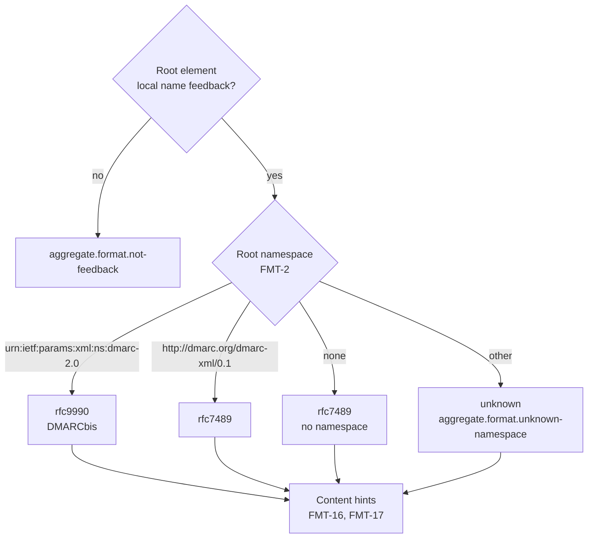

# Format

How an element tree becomes a report. It covers the two schemas: RFC 9990 Appendix A (DMARCbis) and RFC 7489 Appendix C. Input to this step: [XML reader](xml.md).

## Namespace and format

| ID | Rule |
|---|---|
| FMT-1 | The root element's local name must be `feedback` (§3.1.1.1; RFC 7489 Appendix C). Otherwise `aggregate.format.not-feedback` (error), and the document is not a report. |
| FMT-2 | The root element's namespace decides the declared format (table below). The report keeps the namespace URI as written, or null, and the root prefix, if any. |
| FMT-3 | Every element of a report is read by the rules of its declared format. An `unknown` report is read with the RFC 9990 rules. |

| Root namespace | Format | Label in the UI | Source |
|---|---|---|---|
| `urn:ietf:params:xml:ns:dmarc-2.0` | `rfc9990` | RFC 9990 (DMARCbis) | §3.1.1.1, §6.1, Appendix A `targetNamespace` |
| `http://dmarc.org/dmarc-xml/0.1` | `rfc7489` | RFC 7489 | RFC 7489 Appendix C `targetNamespace` |
| None | `rfc7489` | RFC 7489, no namespace | RFC 9990 requires the namespace (§3.1.1.1), so a report without one follows the older practice |
| Any other URI | `unknown` | Unknown namespace, with the URI | `aggregate.format.unknown-namespace` (warning) |

How the two schemas place child elements in namespaces:

| | RFC 9990 Appendix A | RFC 7489 Appendix C |
|---|---|---|
| `targetNamespace` | `urn:ietf:params:xml:ns:dmarc-2.0` | `http://dmarc.org/dmarc-xml/0.1` |
| `elementFormDefault` | `qualified`: child elements are in the namespace | Not set: by XML Schema's default, child elements are in no namespace |
| Extensions | Namespaced elements in `extension` and at the end of `record` (§3.1.1.6, §3.1.1.7, §5) | None |

## Elements

| ID | Rule |
|---|---|
| FMT-4 | A child element is a report element when its namespace is the root's namespace or none. This accepts both qualified and unqualified children. Any other namespace makes it an extension element (§5). |
| FMT-5 | Extension elements are counted per namespace URI and position (`extension` or record level) and are not interpreted (§3.2: their presence "SHOULD NOT create an error"). An `extension` element is read the same way in every format. |
| FMT-6 | A report element whose local name is not in the table below gives `aggregate.schema.unknown-element` (info) with its path, and is ignored. |
| FMT-7 | Elements are found by name, not position. The order required by §3.1.1.2, §3.1.1.7, §3.1.1.9, §3.1.1.11, and the RFC 7489 `xs:sequence` types is not checked. |
| FMT-8 | A required element (multiplicity `R` or `+` in the declared format's column) that is missing gives `aggregate.schema.missing` (warning) with its path. The effect is in the last column. |
| FMT-9 | An element that may appear once but appears more than once gives `aggregate.schema.repeated` (info); the first one is used. RFC 7489 allows several `auth_results/spf`: the first one with `scope` `mfrom` is used, else the first; all are kept in the record. Several `error` elements are all kept, in every format. |

Multiplicity: `R` exactly one, `O` zero or one, `*` zero or more, `+` one or more, `no` not in that schema.

| Path | RFC 7489 | RFC 9990 | Read as | If missing |
|---|---|---|---|---|
| `version` | R | O | Decimal (FMT-13) | Nothing |
| `report_metadata/org_name` | R | R | Text | Reporter is "(unknown)" |
| `report_metadata/email` | R | R | Text | Nothing |
| `report_metadata/extra_contact_info` | O | O | Text, `lang` | Nothing |
| `report_metadata/report_id` | R | R | Text | Report is never a duplicate (CMB-1) |
| `report_metadata/date_range/begin` | R | R | Integer, seconds since the epoch | Report is undated (CMB-7) |
| `report_metadata/date_range/end` | R | R | Integer, seconds since the epoch | Report is undated (CMB-7) |
| `report_metadata/error` | * | O | Text, `lang` | Nothing |
| `report_metadata/generator` | no | O | Text | Nothing |
| `policy_published/domain` | R | R | Domain | Policy domain is "(unknown)" |
| `policy_published/adkim` | O | O | `r`, `s` | Shown as not stated (default `r`) |
| `policy_published/aspf` | O | O | `r`, `s` | Shown as not stated (default `r`) |
| `policy_published/p` | R | R | `none`, `quarantine`, `reject` | Shown as unknown |
| `policy_published/sp` | R | O | Same as `p` | Shown as not stated |
| `policy_published/np` | no | O | Same as `p` | Shown as not stated |
| `policy_published/pct` | R | no | Integer 0 to 100 | Shown as not stated (default 100) |
| `policy_published/fo` | R | O | Text | Shown as not stated |
| `policy_published/discovery_method` | no | O | `psl`, `treewalk` | Shown as not stated |
| `policy_published/testing` | no | O | `n`, `y` | Shown as not stated (default `n`) |
| `extension` | no | O | FMT-5 | Nothing |
| `record` | + | + | | Report has no records |
| `record/row/source_ip` | R | R | IP address (FMT-12) | Record skipped (FMT-18) |
| `record/row/count` | R | R | Integer ≥ 0 | Record skipped (FMT-18) |
| `record/row/policy_evaluated/disposition` | R | R | `none`, `quarantine`, `reject`; RFC 9990 adds `pass` | Shown as unknown |
| `record/row/policy_evaluated/dkim` | R | R | `pass`, `fail` | Record skipped (FMT-18) |
| `record/row/policy_evaluated/spf` | R | R | `pass`, `fail` | Record skipped (FMT-18) |
| `record/row/policy_evaluated/reason` | * | * | | Nothing |
| `…/reason/type` | R | R | Override type (table below) | The reason is skipped |
| `…/reason/comment` | O | O | Text; RFC 9990 adds `lang` | Nothing |
| `record/identifiers/header_from` | R | R | Domain | Author domain is null |
| `record/identifiers/envelope_from` | R | O | Domain; empty means a null reverse-path (§3.1.1.10) | Null |
| `record/identifiers/envelope_to` | O | O | Domain | Null |
| `record/auth_results/dkim` | * | * | | No DKIM results |
| `…/dkim/domain` | R | R | Domain | The DKIM result is skipped |
| `…/dkim/selector` | O | R | Text | Null |
| `…/dkim/result` | R | R | `none`, `pass`, `fail`, `policy`, `neutral`, `temperror`, `permerror` | The DKIM result is skipped |
| `…/dkim/human_result` | O | O | Text; RFC 9990 adds `lang` | Nothing |
| `record/auth_results/spf` | + | O | | No SPF result |
| `…/spf/domain` | R | R | Domain | The SPF result is skipped |
| `…/spf/scope` | R | O | RFC 7489: `helo`, `mfrom`; RFC 9990: `mfrom` | Null |
| `…/spf/result` | R | R | `none`, `neutral`, `pass`, `fail`, `softfail`, `temperror`, `permerror`; RFC 9990 adds `policy` | The SPF result is skipped |
| `…/spf/human_result` | no | O | Text, `lang` | Nothing |

Override types (`reason/type`):

| Value | RFC 7489 | RFC 9990 | Meaning |
|---|---|---|---|
| `forwarded` | yes | no | Relayed by a known or likely forwarder |
| `sampled_out` | yes | no | Exempted by `pct` |
| `trusted_forwarder` | yes | yes | Failure expected from a trusted forwarder |
| `mailing_list` | yes | yes | Arrived through a mailing list |
| `local_policy` | yes | yes | The receiver's local policy exempted it |
| `other` | yes | yes | See `comment` |
| `policy_test_mode` | no | yes | Exempted by `t=y` |

Sources: §3.1.6; RFC 7489 Appendix C, "Descriptions of the PolicyOverrideTypes".

## Values

| ID | Rule |
|---|---|
| FMT-10 | Enumerated values are trimmed (XML-9), compared case-insensitively, and reported lowercase. A value in neither schema's enumeration gives `aggregate.value.unknown` (warning) with path and value, and is kept as written. A value from the other schema is accepted and listed as a content hint (FMT-16). |
| FMT-11 | Text values are kept up to 4 096 characters. Longer ones are cut and marked truncated. |
| FMT-12 | `source_ip` is an IPv4 address in dotted-decimal form or an IPv6 address (§3.1.1.8; RFC 3986 §3.2.2). IPv6 is rewritten in the form of RFC 5952 §4, and an IPv4-mapped IPv6 address (`::ffff:a.b.c.d`) becomes the IPv4 address, so that equal addresses group together. Anything else gives `aggregate.value.invalid` (warning); the record is kept, its source is the text as written, and it is never looked up (RDNS-1). |
| FMT-13 | `begin`, `end`, `count`, and `pct` are integers: optional sign, then decimal digits. A value that is not an integer, a negative `count`, a `count` above 2^53 − 1, or a `pct` outside 0 to 100 gives `aggregate.value.invalid` (warning) and is treated as missing (FMT-8). An invalid `count` is the exception: FMT-18 reports it. `version`, when present, must equal 1.0 as a decimal (`1`, `1.0`, and `1.00` are equal), else `aggregate.format.version` (info) (§3.1.1.2; RFC 7489 Appendix C). |
| FMT-14 | Domain values are trimmed, a trailing dot is removed, and ASCII letters are lowercased. |
| FMT-15 | For SPF results, `unknown` is read as `temperror` and `error` as `permerror`, with `aggregate.value.legacy` (info). The RFC 7489 schema notes these older spellings ("commonly implemented as"). The original text is kept. |
| FMT-18 | A record is skipped when `source_ip`, `policy_evaluated/dkim`, or `policy_evaluated/spf` is missing (`policy_evaluated` itself missing counts as both), or when `count` is missing or invalid by FMT-13. A skipped record gives one `aggregate.record.skipped` (warning) naming every such element, and no `aggregate.schema.missing` or `aggregate.value.invalid` for them. An unknown value in `policy_evaluated/dkim` or `spf` (FMT-10) does not skip the record; FCT-1 treats it as not `pass`. |

## Content hints

Content that exists in only one of the two schemas. It shows which format a report follows in practice, whatever its namespace says.

| ID | Rule |
|---|---|
| FMT-16 | Each report lists the content hints it contains, by format (table below), with the paths where they occur. |
| FMT-17 | A report whose declared format is `rfc9990` or `rfc7489` and that holds hints of the other format gives `aggregate.format.mixed` (info) listing them. The declared format does not change. `unknown` reports list hints without this finding. |

| Format | Hint |
|---|---|
| RFC 9990 only | `generator`; `np`; `discovery_method`; `testing`; `extension`; extension elements at record level; `spf/human_result`; a `lang` attribute; disposition `pass`; SPF result `policy`; override type `policy_test_mode` |
| RFC 7489 only | `pct`; override types `forwarded` and `sampled_out`; SPF scope `helo`; more than one `spf` in `auth_results`; more than one `error` |

`dkim/selector` missing and `envelope_from` missing are not hints. They are allowed in one schema and required in the other, so FMT-8 already reports them.
