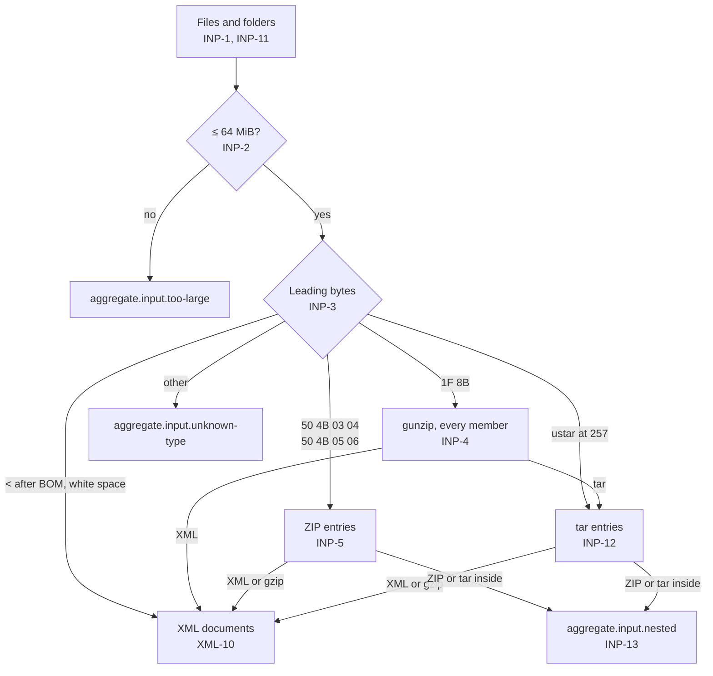

# Input

How files become report documents. What happens to a document next: [XML reader](xml.md). Requirements: [REQ-DMARC-003](../../explanation/requirements/REQ-DMARC-003-combine-reports.md), [REQ-DMARC-011](../../explanation/requirements/REQ-DMARC-011-bulk-input.md).



## Files and folders

| ID | Rule |
|---|---|
| INP-1 | Input comes from a drop or a picker. A drop may hold files and folders. One picker takes several files at once; another takes a folder. Each drop or pick adds its files to the batch: dropped or picked files in the order given, then each folder's files (INP-11). "Clear" empties the batch. The worker reads files in order. |
| INP-2 | A file over 64 MiB gives `aggregate.input.too-large` (error) and is not read. After 20 000 files in a batch, `aggregate.input.too-many-files` (error), once per add that goes past the limit, and later files are not read or listed. A file too large is listed with status `failed`. |
| INP-11 | A folder is read with its subfolders. Its files are taken in order of their path relative to the folder, compared by code point. Each file's name is that relative path. A file from a folder that is unknown by INP-3, too large by INP-2, or has a name starting with `.` gives no finding of its own: each add gives one `aggregate.input.skipped` (info) with the count and the first 20 paths, once the last of that add's folder files is decided. Those files get status `skipped`. Files dropped or picked one by one keep their own findings. |

## Kinds

| ID | Rule |
|---|---|
| INP-3 | The kind comes from the leading bytes, never the name. `1F 8B` is gzip (RFC 1952 §2.3.1). `50 4B 03 04` or `50 4B 05 06` is ZIP (APPNOTE 4.3.7, 4.3.16). `ustar` at offset 257 is tar (INP-12). XML when, after an optional UTF-8 BOM (`EF BB BF`) or UTF-16 BOM (`FE FF`, `FF FE`) and XML white space, the next character is `<`. The kind is decided from the first 262 bytes, or all bytes when fewer. When all 262 hold only XML white space after the BOM, the input is read as XML; a shorter input with no `<` is unknown. Anything else gives `aggregate.input.unknown-type` (error) and is skipped. Its message says that only aggregate reports (XML, gzip, ZIP, tar) are read, so a failure report dropped by mistake is explained. |
| INP-4 | gzip data is decompressed as a stream, member after member, until the input ends (RFC 1952 §2.2: a file is a series of members). The output is XML, possibly several documents (XML-10), or a tar archive (INP-12), by INP-3. Anything else gives `aggregate.input.unknown-type`. A decompression error gives `aggregate.input.gzip` (error); the reports completed before it stay. Errors include a bad member header (including a wrong FHCRC), a member whose CRC-32 or ISIZE does not match its output (§2.3.1), a member cut short, and bytes after a member that neither start another one nor are all zero. Zero padding after the last member is accepted. |
| INP-5 | A ZIP file is read with `@benchside/zip` and its default parameters. Each entry that is a file is opened in central directory order: stored (method 0) or deflated (method 8), not encrypted. A directory entry is skipped without a finding. Encrypted entries, other methods, entries whose data the reader could not locate, and entries that fail to inflate give `aggregate.zip.entry-skipped` (warning) with the reason. For an entry that fails part way, the reports completed before the failure stay, as for gzip (INP-4). A CRC-32 mismatch gives `aggregate.zip.crc` (warning); the entry is still read. A ZIP file the reader cannot open gives `aggregate.zip.unreadable` (error). After 1 000 file entries, `aggregate.zip.too-many-entries` (warning), and later entries are not read. |
| INP-12 | A tar archive is a series of 512-byte header blocks, each followed by its data padded to 512 bytes (POSIX.1-2017 pax, "ustar Interchange Format"). Read: regular files (type `0` or NUL), with the name from `prefix` and `name`, a pax extended header `path` record (type `x`), or a GNU long name (type `L`). Other types (directories, links, devices) are skipped without a finding. Sizes are octal, or base-256 when the first byte has its high bit set. The checksum is the sum of the header bytes with the checksum field read as spaces, taken as unsigned or signed bytes, since old tools wrote either. A header whose checksum does not match, a pax or GNU long-name header over 1 MiB, or data that ends early gives `aggregate.tar.malformed` (error); the reports read before it stay. Padding missing after the last entry's data is not an error. Two zero blocks, or the end of the data, end the archive. After 10 000 file entries, `aggregate.tar.too-many-entries` (warning), and later entries are not read. |
| INP-13 | Allowed nesting: a file may be XML, gzip, ZIP, or tar. gzip may hold XML or tar. ZIP and tar entries may hold XML or gzip, and that gzip may hold XML only. Such a gzip entry is read whole; over 64 MiB it gives `aggregate.input.too-large` and is skipped. Anything else inside an archive gives `aggregate.input.nested` (warning) and is skipped. |
| INP-14 | A file the browser cannot read, for example because it was moved or changed after it was picked, gives `aggregate.input.unreadable` (error). Its status is `failed`, and reading goes on with the next file. |

## Limits and labels

| ID | Rule |
|---|---|
| INP-6 | Every byte decompressed counts toward a 1 GiB batch budget. Past it, `aggregate.input.budget` (error); later files are not read. One XML document over 32 MiB gives `aggregate.input.too-large`; it is not read, and reading of that input stops there, as for other XML errors (XML-6). Output past either limit is reported as such even when the compressed data is also damaged after it (INP-4). |
| INP-7 | Each XML document is one report. Its label is the file name; then, for each archive entry, ` › ` and the entry name; then, when the XML holds more than one document, ` #` and the document number from 1. Example: `week.tar.gz › 2026/11/a.xml.gz #2`. Findings and reports carry this label. |

## File names

RFC 9990 §3.5.2 and RFC 7489 §7.2.1.1 define the name of the report attachment:

```
receiver "!" policy-domain "!" begin-timestamp "!" end-timestamp [ "!" unique-id ] "." extension
```

| ID | Rule |
|---|---|
| INP-8 | The innermost name (the last path segment, after `/` or `\`, of the innermost entry or file) is parsed by the grammar above. The extension is everything from the first `.` after the last `!`. Timestamps are decimal digits. A name with 4 or 5 `!`-separated parts, a non-empty receiver, policy domain, and unique ID when present, and timestamps of digits below 2^53 is parsed; any other name is not, and that is not a finding. A name that holds several documents (XML-10) is not compared. |
| INP-9 | When parsed, the name's policy domain is compared with `policy_published/domain` (case-insensitive, trailing dot ignored), and its timestamps with `date_range/begin` and `end`. Any difference gives `aggregate.filename.mismatch` (info) listing the parts that differ. |
| INP-10 | The parsed receiver and unique ID are reported with the report. They are not used for identity (CMB-1). |
