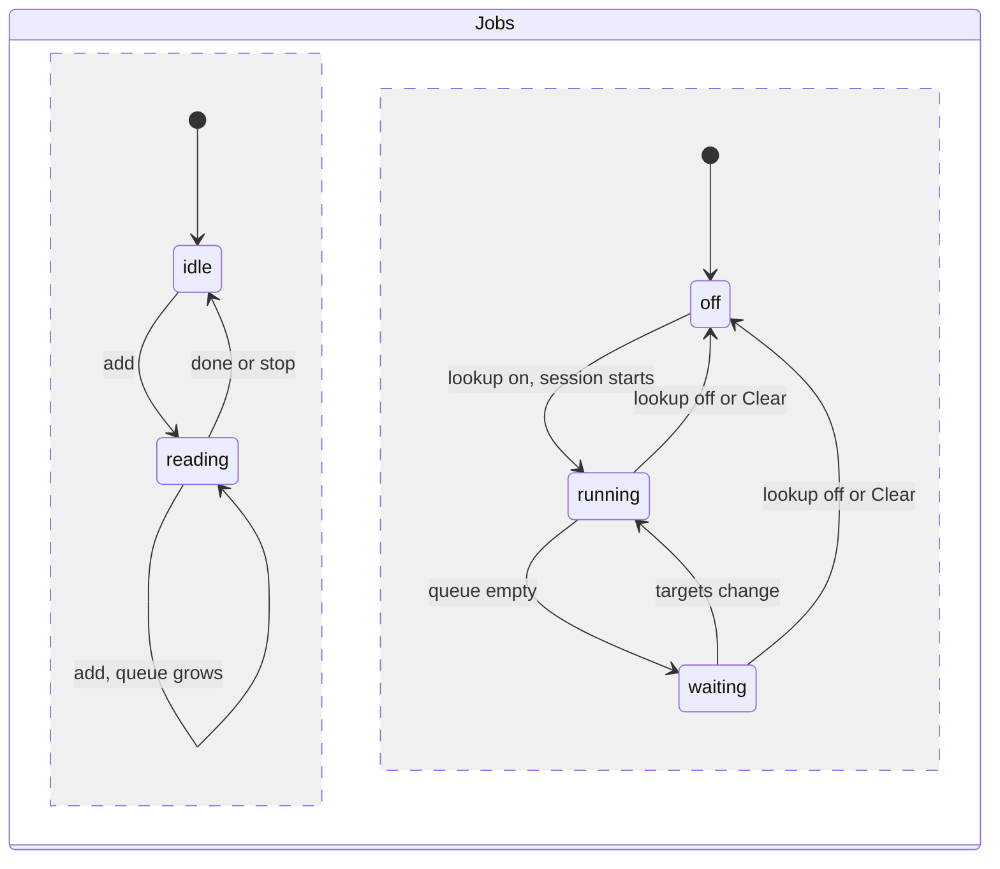

# Progress

How results reach the UI while files are read and host names are looked up. Requirement: [REQ-DMARC-010](../../explanation/requirements/REQ-DMARC-010-live-results.md). Display: [UI design](../../explanation/dmarc-aggregate-design/ui.md#progress).

## Jobs

Two jobs can run at the same time and do not wait for each other.

| ID | Rule |
|---|---|
| PRG-1 | The reading job reads the queued files in order (INP-1). An `add` while reading appends its files to the queue. |
| PRG-2 | The lookup job runs as RDNS-2 describes. It uses only the reports counted so far. Each snapshot can add targets, so sources from later reports are looked up while reading goes on. |
| PRG-3 | "Clear" stops both jobs, then empties the batch. |
| PRG-13 | Every `snapshot`, `view`, and `names` message carries the batch generation, which starts at 1 and grows by one at each "Clear". `names` also carries the lookup session number, which grows by one each time lookups are turned on. The UI drops any message from an older generation or session. |

## Snapshots

| ID | Rule |
|---|---|
| PRG-4 | While reading, the worker sends a snapshot: after the first report is counted, then whenever 250 ms have passed since the last one, and once when reading ends. A snapshot holds the `Batch`, the `View` for the latest filters, and the reading progress. |
| PRG-5 | A snapshot sent while reading has `partial: true`. Its `View` covers the reports counted so far. The last snapshot has `partial: false`. |
| PRG-6 | Reading progress: input bytes read and total, top-level files read and total, reports counted, and the phase: `reading`, `done`, or `stopped`. The byte total is the sum of the queued files' sizes; it grows when files are added. |
| PRG-7 | Records can change class between snapshots when a later report reveals a forwarder IP (FCT-7). Each snapshot is computed fresh from the counted reports, so the last one is correct. |
| PRG-8 | The worker reads in steps of at most 50 ms of work and checks for messages between steps. A `view` request during reading is answered with a view of the reports counted so far, within one step. |

## Stop

| ID | Rule |
|---|---|
| PRG-9 | "Stop" ends reading at the end of the current step. A report half read is dropped. Files not finished get the status `stopped` in `files`; the reports counted so far stay. The phase becomes `stopped`. |
| PRG-10 | Stopping the lookup job is RDNS-9. |

## Lookup progress

| ID | Rule |
|---|---|
| PRG-11 | Each target in a session has a state: `queued`, `looking-up`, then a final state of RDNS-5. |
| PRG-12 | The worker sends `names` with the states that changed: whenever 250 ms have passed since the last one, and once when the queue empties. Each `names` carries the session's counts: queued, looking up, done, and targets. |
