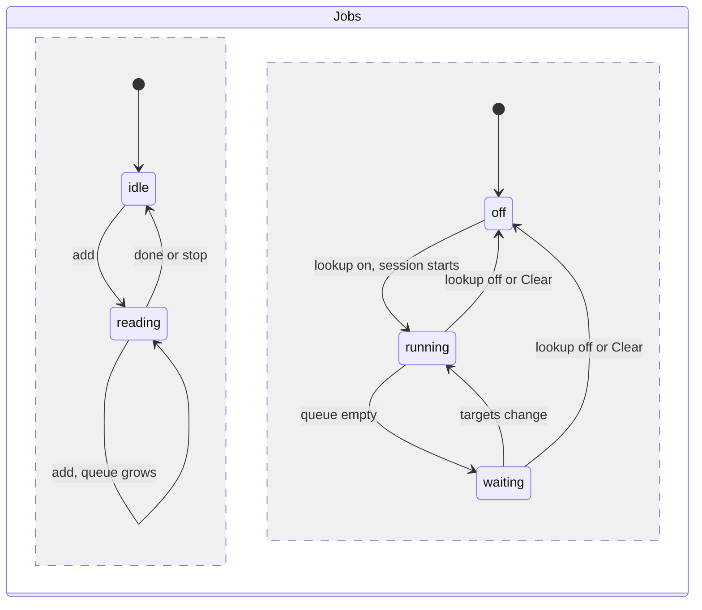

# Progress

How results reach the UI while files are read and host names are looked up. Requirement: [REQ-DMARC-010](../../explanation/requirements/REQ-DMARC-010-live-results.md). Display: [UI design](../../explanation/dmarc-aggregate-design/ui.md#progress).

## Jobs

Two jobs can run at the same time and do not wait for each other.

| ID | Rule |
|---|---|
| PRG-1 | The reading job reads the queued files in order (INP-1). An `add` while reading appends its files to the queue. |
| PRG-2 | The lookup job runs as RDNS-2 describes. It uses only the reports counted so far. Each snapshot can add targets, so sources from later reports are looked up while reading goes on. |
| PRG-3 | "Clear" stops both jobs, then empties the batch. |
| PRG-13 | Every `snapshot` and `names` message carries the batch generation, which starts at 1 and grows by one at each "Clear". The UI drops any message from an older generation. `names` also carries the lookup session number, which grows by one each time lookups are turned on. A session is active from turning lookups on until turning them off. When the user turns lookups off, the UI at once removes every `queued` and `looking-up` state, so those sources show "not looked up", and the session ends. From the active session the UI applies every state change and the counts (PRG-12). From an ended session of the current generation it applies only final states (RDNS-5), and only for sources that have no state from a newer session, since a result is valid whichever session found it; `queued` and `looking-up` from an ended session are ignored. A late `names` from the session just turned off is therefore read as an ended session's message. Findings in a `names` (PRG-12) apply from every session of the current generation. |

## Snapshots

| ID | Rule |
|---|---|
| PRG-4 | While reading, the worker sends a snapshot: when reading starts, then whenever 250 ms have passed since the last one, and once when reading ends. The first one comes before any report is counted, so the indicator appears at once even when no file holds a report. A snapshot holds the batch changes (PRG-14), the `View` for the latest filters, and the reading progress. |
| PRG-5 | A snapshot sent while reading has `partial: true`. Its `View`, when it has one (PRG-16), covers the reports counted so far. The last snapshot has `partial: false`. |
| PRG-6 | Reading progress: input bytes read and total, top-level files read and total, reports counted, and the phase: `reading`, `done`, or `stopped`. The byte total is the sum of the queued files' sizes; it grows when files are added. |
| PRG-7 | Records can change class between snapshots when a later report reveals a forwarder IP (FCT-7). Each snapshot is computed fresh from the counted reports, so the last one is correct. |
| PRG-8 | The worker reads in steps of at most 50 ms of work and checks for messages between steps. A `view` request is answered with a snapshot, within one step, whether or not reading is running. |
| PRG-14 | A snapshot carries only what changed in the batch since the previous snapshot of the same generation: files, reports, and findings added, and files whose status changed. The UI keeps the lists. Batch changes hold only what is fixed once a report is read: its summary and status (CMB-2, CMB-3), and findings about that report or file. None depends on classification, which can change (PRG-7); classification reaches the UI only through the `View`. The one exception is `policies` (CMB-8): it is not per report, so it is sent whole each time it changes (REP-11). Progress and `partial` are always complete. |
| PRG-16 | A snapshot's `View` is complete or null. It is null when no report was counted since the previous snapshot of the same generation and that snapshot had the same filters and focus, so the `View` did not change. The last snapshot of reading (`partial: false`) and every answer to a `view` request (PRG-8) always carry the `View`. The UI keeps the `View` it shows when a snapshot's `View` is null. |
| PRG-15 | The UI takes the batch changes and the progress from every snapshot of the current generation, so the indicator always reaches the end of reading. It shows a snapshot's `View` only when the snapshot has one (PRG-16) and its filters and focus (SRC-5) match the current ones. The indicator shows the newest progress. The partial label shows while the `View` shown came from a partial snapshot, or while the newest snapshot is partial (reading is running, even if its `View` is null). Its counts come from the newest snapshot. It goes away when a snapshot with `partial: false` arrives and its `View` is shown. |

## Stop

| ID | Rule |
|---|---|
| PRG-9 | "Stop" ends reading at the end of the current step. A report half read is dropped. Files not finished get the status `stopped`, sent as file status changes (PRG-14); the reports counted so far stay. The phase becomes `stopped`. |
| PRG-10 | Stopping the lookup job is RDNS-9. |

## Lookup progress

| ID | Rule |
|---|---|
| PRG-11 | Each target in a session has a state: `queued`, `looking-up`, then a final state of RDNS-5. A queued source that leaves the queue (RDNS-2) is sent as `removed`; the UI then drops its state and shows "not looked up". |
| PRG-12 | The worker sends `names` with the states that changed: whenever 250 ms have passed since the last one, and once when the queue empties. Each `names` carries the session's counts: queued, looking up, done, and targets. When the session's budget runs out (RDNS-6), the next `names` carries the `dns.budget-exhausted` finding once; the UI shows it with the query log. |
