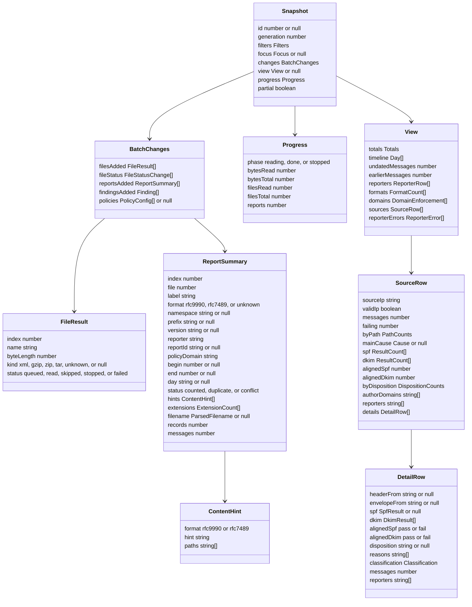
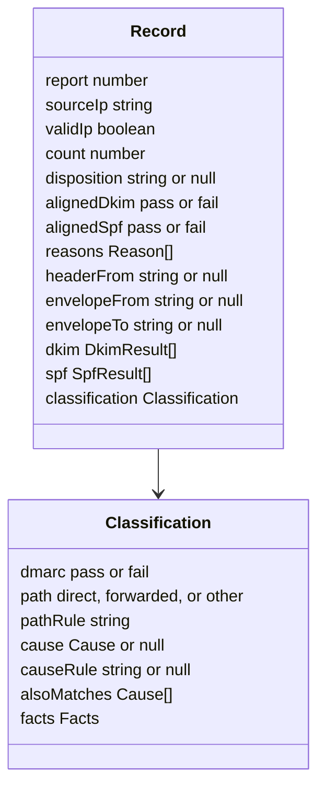

# Report

The output of `@benchside/dmarc-aggregate`: plain data, no DOM, safe to pass to the UI with `postMessage`. The worker keeps the loaded reports. The UI receives snapshots: the batch changes since the last one, a `View` for the current filters, and `Progress` ([Progress](progress.md)).

## Data model

What crosses to the UI. Only these types, `Names` in the table below, and the `DnsLogEntry` items it carries (DNS-15) are posted.

What stays in the worker. These are never posted.

| Type | Holds | Rules |
|---|---|---|
| `Finding` | `id`, `severity`, `message`, `file`, `label`; and when known `report`, `record`, `path`, `line`, `column` | REP-7, REP-8 |
| `Totals` | CMB-9; the period is null when no report in the filtered set is dated | |
| `Day` | Date, messages by path, pass rate | CMB-10 |
| `ReporterRow` | CMB-11 | |
| `FormatCount` | Format, namespace, reports, mixed | CMB-12 |
| `PolicyConfig` | One configuration of a policy domain, its reporters and days; not filtered, so it rides on the batch changes, not the `View` | CMB-8 |
| `Focus` | A delivery path or a cause | SRC-5 |
| `FileStatusChange` | A file `index`, its new `status`, and, once the status is final, the file's `kind` (null when it was not read), `reports`, and `findings` counts. A `FileResult` has `kind` null until then | PRG-14, REP-1 |
| `DomainEnforcement` | ENF-1 to ENF-7 for one policy domain | |
| `ReporterError` | CMB-13 | |
| `ResultCount` | One raw result with its domain (and selector for DKIM) and messages | SRC-2 |
| `Names` | The `names` message: `generation`, `session`, `changes` (source IP to state: `queued`, `looking-up`, `removed`, or a final state of RDNS-5 with its names or rcode), `counts` (queued, looking up, done, targets), `log` (new `DnsLogEntry` items of `@benchside/dns`, DNS-15), and `findings` | PRG-11 to PRG-13 |

| ID | Rule |
|---|---|
| REP-1 | Files keep the order of INP-1; `index` numbers them from 0. A file's `name` is its relative path when it came from a folder (INP-11). Its `status` is `queued` until read; `skipped` for INP-11 skips; `stopped` by PRG-9; `failed` when it gave an error finding and no report. Reports are numbered in the order they were read; `index` is stable until "Clear". A report's `file` is the `index` of the top-level file it came from. A file's status is final when it is `read`, `skipped`, `stopped`, or `failed`; its counts are the reports read from it and the findings kept (REP-8) whose file it is (REP-7). |
| REP-2 | `format`, `namespace`, and `prefix` come from FMT-2. `version` is the text as written. `hints` come from FMT-16, `extensions` from FMT-5, `filename` from INP-8. |
| REP-3 | `status` is `counted`, `duplicate` (CMB-2), or `conflict` (CMB-3). Only counted reports contribute records to a `View`. |
| REP-4 | `day` is the UTC day of CMB-7 as `YYYY-MM-DD`, or null when undated. `begin` and `end` are seconds since the epoch, as in the report. |
| REP-5 | A record's `spf` keeps every SPF result in order (FMT-9). The one used by FCT-4 is marked. Each `DkimResult` has `domain`, `selector`, `result`, and `humanResult`; each `SpfResult` has `domain`, `scope`, `result`, `original` (FMT-15), and `humanResult`. |
| REP-6 | A `View` is computed for one set of filters (CMB-6) and one path or cause filter (SRC-5). Its parts follow CMB-9 to CMB-13, ENF-1 to ENF-7, and SRC-1 to SRC-4. Rows not yet shown (SRC-6) are still in the `View`, so "Show more" needs no new request. |
| REP-7 | A finding carries the `index` of the file it belongs to, and the label (INP-7) of the part it is about, which starts with the file's name: the top-level file being read when it was found, even when it is about an earlier report (CMB-4). A finding raised at `add` carries the file it is about (INP-2 `aggregate.input.too-large`); `aggregate.input.too-many-files` and `aggregate.input.skipped` cover many files and carry null. Other findings about a file, such as `aggregate.input.unknown-type`, are raised when it is read. When they have one, findings also carry the report index, the record index within the report, the element path, and the XML line. |
| REP-8 | Findings keep the order in which they were found. After 10 000, one `aggregate.too-many-findings` (warning) is added and later ones are dropped. `dns.budget-exhausted` is not part of this list or its limit: it comes in `names`, at most once per session, and is shown with the query log (PRG-12). |
| REP-9 | `changes`, `view`, `partial`, `Progress`, and the timing of snapshots follow PRG-4 to PRG-6 and PRG-14 to PRG-16. Host name states arrive only in `names` messages, keyed by source IP; `SourceRow` carries none (RDNS-8, PRG-11 to PRG-13). |
| REP-10 | `Record` and `Classification` stay in the worker. The UI sees records only through `SourceRow` and `DetailRow`, which group them (SRC-1, SRC-4). |
| REP-11 | `id` is the `view` request a snapshot answers (PRG-8), or null for a periodic one. `policies` in the batch changes is the full list of CMB-8 when it changed since the previous snapshot, else null. |

## Findings

| ID | Severity | Rule |
|---|---|---|
| `aggregate.input.too-large` | error | INP-2, INP-6 |
| `aggregate.input.too-many-files` | error | INP-2 |
| `aggregate.input.unknown-type` | error | INP-3, INP-4 |
| `aggregate.input.gzip` | error | INP-4 |
| `aggregate.input.budget` | error | INP-6 |
| `aggregate.input.unreadable` | error | INP-14 |
| `aggregate.input.skipped` | info | INP-11 |
| `aggregate.input.nested` | warning | INP-13 |
| `aggregate.zip.unreadable` | error | INP-5 |
| `aggregate.zip.entry-skipped` | warning | INP-5 |
| `aggregate.zip.crc` | warning | INP-5 |
| `aggregate.zip.too-many-entries` | warning | INP-5 |
| `aggregate.tar.malformed` | error | INP-12 |
| `aggregate.tar.too-many-entries` | warning | INP-12 |
| `aggregate.filename.mismatch` | info | INP-9 |
| `aggregate.xml.encoding` | error or warning | XML-1, XML-2, XML-10 |
| `aggregate.xml.doctype` | error | XML-4 |
| `aggregate.xml.malformed` | error | XML-5, XML-6, XML-7, XML-10 |
| `aggregate.format.not-feedback` | error | FMT-1 |
| `aggregate.format.unknown-namespace` | warning | FMT-2 |
| `aggregate.format.version` | info | FMT-13 |
| `aggregate.format.mixed` | info | FMT-17 |
| `aggregate.schema.unknown-element` | info | FMT-6 |
| `aggregate.schema.missing` | warning | FMT-8 |
| `aggregate.schema.repeated` | info | FMT-9 |
| `aggregate.value.unknown` | warning | FMT-10 |
| `aggregate.value.invalid` | warning | FMT-12, FMT-13, CMB-7 |
| `aggregate.value.legacy` | info | FMT-15 |
| `aggregate.record.skipped` | warning | FMT-18 |
| `aggregate.record.too-many-dkim` | info | Limits |
| `aggregate.record.inconsistent` | info | FCT-6 |
| `aggregate.record.no-reason` | info | ENF-6 |
| `aggregate.report.duplicate` | info | CMB-2 |
| `aggregate.report.conflict` | warning | CMB-3 |
| `aggregate.report.overlap` | warning | CMB-4 |
| `aggregate.report.long-range` | info | CMB-7 |
| `aggregate.report.future` | warning | CMB-7 |
| `aggregate.report.error` | info | CMB-13 |
| `aggregate.policy.changed` | info | CMB-8 |
| `aggregate.too-many-records` | error | Limits |
| `aggregate.too-many-findings` | warning | REP-8 |
| `dns.budget-exhausted` | error | RDNS-6, DNS-13; sent in `names` (PRG-12) |
