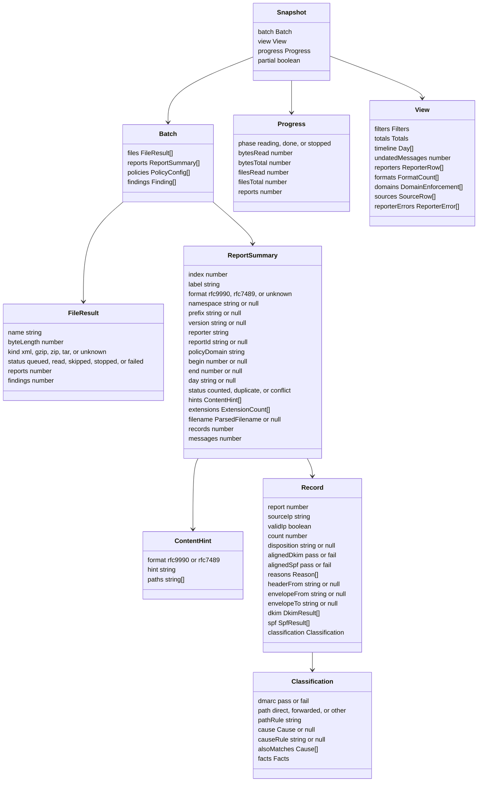

# Report

The output of `@benchside/dmarc-aggregate`: plain data, no DOM, safe to pass to the UI with `postMessage`. The worker keeps the loaded reports. The UI receives snapshots: a `Batch`, a `View` for the current filters, and `Progress` ([Progress](progress.md)).

## Data model

| ID | Rule |
|---|---|
| REP-1 | `files` keep the order of INP-1. A file's `name` is its relative path when it came from a folder (INP-11). Its `status` is `queued` until read; `skipped` for INP-11 skips; `stopped` by PRG-9; `failed` when it gave an error finding and no report. `reports` are numbered in the order they were read; `index` is stable until "Clear". |
| REP-2 | `format`, `namespace`, and `prefix` come from FMT-2. `version` is the text as written. `hints` come from FMT-16, `extensions` from FMT-5, `filename` from INP-8. |
| REP-3 | `status` is `counted`, `duplicate` (CMB-2), or `conflict` (CMB-3). Only counted reports contribute records to a `View`. |
| REP-4 | `day` is the UTC day of CMB-7 as `YYYY-MM-DD`, or null when undated. `begin` and `end` are seconds since the epoch, as in the report. |
| REP-5 | A record's `spf` keeps every SPF result in order (FMT-9). The one used by FCT-4 is marked. Each `DkimResult` has `domain`, `selector`, `result`, and `humanResult`; each `SpfResult` has `domain`, `scope`, `result`, `original` (FMT-15), and `humanResult`. |
| REP-6 | A `View` is computed for one set of filters (CMB-6) and one path or cause filter (SRC-5). Its parts follow CMB-9 to CMB-13, ENF-1 to ENF-7, and SRC-1 to SRC-4. Rows not yet shown (SRC-6) are still in the `View`, so "Show more" needs no new request. |
| REP-7 | Findings carry the file label and, when they have one, the report index, the record index within the report, the element path, and the XML line. |
| REP-8 | Findings keep the order in which they were found. After 10 000, one `aggregate.too-many-findings` (warning) is added and later ones are dropped. |
| REP-9 | `partial`, `Progress`, and the timing of snapshots follow PRG-4 to PRG-6. A source row's host name state includes `queued` and `looking-up` while a lookup session is active (PRG-11). |

## Findings

| ID | Severity | Rule |
|---|---|---|
| `aggregate.input.too-large` | error | INP-2, INP-6 |
| `aggregate.input.too-many-files` | error | INP-2 |
| `aggregate.input.unknown-type` | error | INP-3, INP-4 |
| `aggregate.input.gzip` | error | INP-4 |
| `aggregate.input.budget` | error | INP-6 |
| `aggregate.input.skipped` | info | INP-11 |
| `aggregate.input.nested` | warning | INP-13 |
| `aggregate.zip.unreadable` | error | INP-5 |
| `aggregate.zip.entry-skipped` | warning | INP-5 |
| `aggregate.zip.crc` | warning | INP-5 |
| `aggregate.zip.too-many-entries` | warning | INP-5 |
| `aggregate.tar.malformed` | error | INP-12 |
| `aggregate.tar.too-many-entries` | warning | INP-12 |
| `aggregate.filename.mismatch` | info | INP-9 |
| `aggregate.xml.encoding` | error or warning | XML-1, XML-2 |
| `aggregate.xml.doctype` | error | XML-4 |
| `aggregate.xml.malformed` | error | XML-5, XML-6, XML-7, XML-10 |
| `aggregate.format.not-feedback` | error | FMT-1 |
| `aggregate.format.unknown-namespace` | warning | FMT-2 |
| `aggregate.format.version` | info | FMT-13 |
| `aggregate.format.mixed` | info | FMT-17 |
| `aggregate.schema.unknown-element` | info | FMT-6 |
| `aggregate.schema.missing` | warning | FMT-8 |
| `aggregate.schema.repeated` | info | FMT-9 |
| `aggregate.value.unknown` | warning | FMT-10 |
| `aggregate.value.invalid` | warning | FMT-12, FMT-13, CMB-7 |
| `aggregate.value.legacy` | info | FMT-15 |
| `aggregate.record.skipped` | warning | FMT-18 |
| `aggregate.record.too-many-dkim` | info | Limits |
| `aggregate.record.inconsistent` | info | FCT-6 |
| `aggregate.record.no-reason` | info | ENF-6 |
| `aggregate.report.duplicate` | info | CMB-2 |
| `aggregate.report.conflict` | warning | CMB-3 |
| `aggregate.report.overlap` | warning | CMB-4 |
| `aggregate.report.long-range` | info | CMB-7 |
| `aggregate.report.error` | info | CMB-13 |
| `aggregate.policy.changed` | info | CMB-8 |
| `aggregate.too-many-records` | error | Limits |
| `aggregate.too-many-findings` | warning | REP-8 |
| `dns.budget-exhausted` | error | RDNS-6, DNS-13 |
