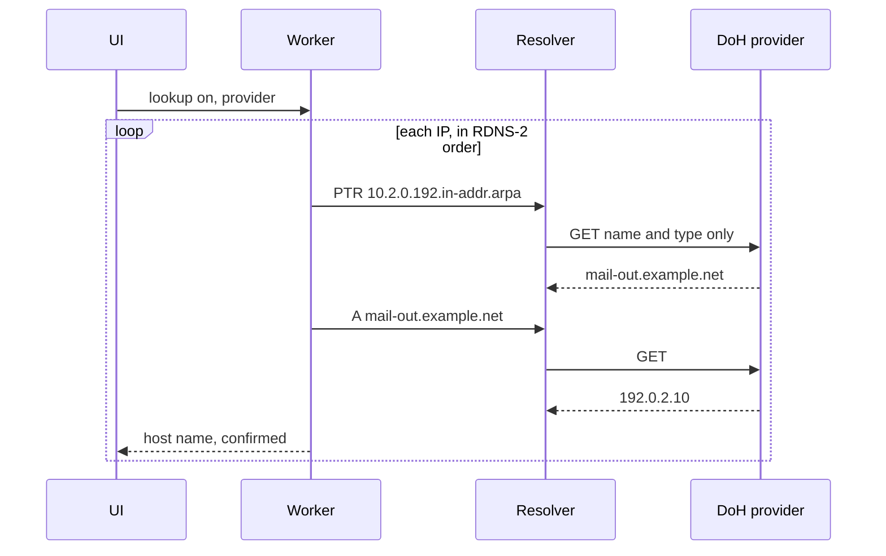

# Reverse DNS

Optional host names for source IPs. Off by default. Lookups run in the app's worker through the shared resolver ([0014](../../explanation/decisions/0014-shared-dns-package.md)). The resolver's own rules (transport, cache, log) are the mail analyzer's [DNS](../mail/dns.md) rules, with the differences below.

| ID | Rule |
|---|---|
| RDNS-1 | Lookups run only while the user has turned them on. The control names the DoH provider and says that source IP addresses are sent as reverse names. Sources that are not valid IP addresses (FMT-12) are never looked up. |
| RDNS-2 | A lookup session lasts from turning lookups on until turning them off or "Clear". During a session the targets are the first 200 rows of the source table as it is shown: the filtered set, with the path or cause focus applied (SRC-5), in the order of SRC-3. The worker recomputes the targets whenever it computes a snapshot (PRG-4, PRG-8); a filter or focus change always produces one. Targets not yet looked up join the queue in that order. Queued sources that are no longer targets leave the queue, so moving the focus back and forth does not spend the budget (RDNS-6) on rows no longer shown. Sources outside the targets show "not looked up". |
| RDNS-3 | The query is `PTR` for the reverse name: the four IPv4 octets in reverse order under `in-addr.arpa` (RFC 1035 §3.5), or the 32 IPv6 nibbles in reverse order under `ip6.arpa` (RFC 3596 §2.5). |
| RDNS-4 | Forward confirmation (RFC 8601 §3): for up to 3 PTR names per IP, in answer order, query `A` for an IPv4 source or `AAAA` for an IPv6 source. A name is confirmed when the source IP is among its answers, compared after normalization (FMT-12). |
| RDNS-5 | Each source gets one final state (while a session is active it may be `queued` or `looking-up`, PRG-11): `confirmed` with the confirmed names; `unconfirmed` with the PTR names when none is confirmed; `none` when the PTR answer is `NXDOMAIN` or has no records; `error` with the rcode for `SERVFAIL`, `TIMEOUT`, or `BUDGET`. Names are shown as text, with a trailing dot removed. |
| RDNS-6 | Differences from the mail resolver: the queries are sensitive (DNS-9), and turning lookups on is the permission to send them (DNS-10); the budget is 2 000 queries per session (not DNS-13's 200); offline mode is not offered. The session cache (DNS-14) and the query log (DNS-15) are the same. |
| RDNS-7 | The query log is shown under the source table, with every query, its rcode, and whether it came from the cache. |
| RDNS-8 | Host names are display only. They never change classification (CAUSE-11), totals, or order. |
| RDNS-9 | Turning lookups off ends the session and stops queries not yet sent. Names already found stay visible until "Clear". Turning lookups on again starts a new session. Sources with a final state of `confirmed`, `unconfirmed`, or `none` are not queried again; sources with `error` are queued again when they are targets. |
