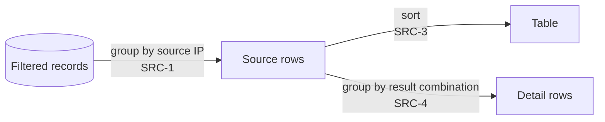

# Sources

The per-IP table of the filtered set. Classification of each record: [Classification](classify.md).

| ID | Rule |
|---|---|
| SRC-1 | One row per source IP in the filtered set, after normalization (FMT-12). An invalid source groups by its text as written. |
| SRC-2 | Each row shows: source IP; host name (RDNS-5) or "not looked up"; messages; DMARC-failing messages; messages by delivery path; the most common cause, by failing messages, ties going to the cause listed first in CAUSE-1..9; every raw SPF result as `domain: result` with messages; every raw DKIM result as `d= / s=: result` with messages, each list sorted by messages, most first; SPF-aligned and DKIM-aligned messages; messages by disposition; author domains; reporters. |
| SRC-3 | Rows are sorted by DMARC-failing messages, most first; then by messages, most first; then by source IP (IPv4 before IPv6, each in numeric order, invalid text last). |
| SRC-4 | Each row expands to detail rows. A detail row is one distinct combination of: author domain, envelope sender, raw SPF result and domain, the set of raw DKIM results (domain, selector, result), aligned SPF and DKIM results, disposition, override types, path, and cause. It shows the summed messages and the reporters. Detail rows are sorted by messages, most first. |
| SRC-5 | Path and cause filters: when a delivery path or cause is selected, rows and detail rows keep only the records with that path or cause, and their numbers are recomputed. |
| SRC-6 | The table shows 100 rows, then "Show more" adds 100. Detail rows show 50, the same way. |
