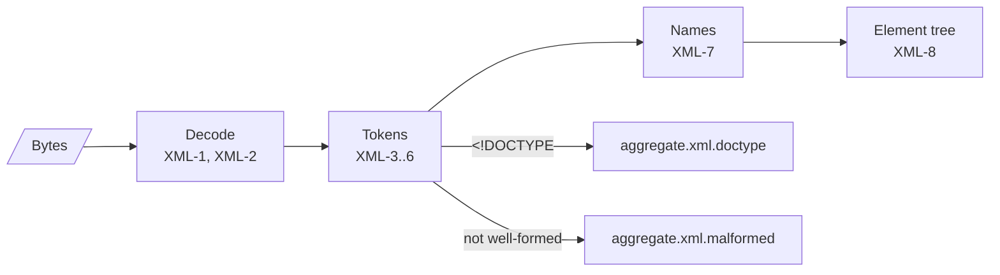

# XML reader

The XML subset `@benchside/dmarc-aggregate` reads. It is a small, non-validating reader written for reports. Why not `DOMParser`: [0015](../../explanation/decisions/0015-dmarc-aggregate-xml-reader.md).

Sources: Extensible Markup Language (XML) 1.0 (Fifth Edition) and Namespaces in XML 1.0 (Third Edition), W3C. This page names their constructs; it does not cite section numbers.

## Decoding

| ID | Rule |
|---|---|
| XML-1 | The encoding is chosen in this order: a UTF-8 BOM gives UTF-8; a UTF-16 BOM gives UTF-16 of that byte order; the `encoding` of the XML declaration, when `TextDecoder` knows its label; otherwise UTF-8. A declared label `TextDecoder` does not know gives `aggregate.xml.encoding` (error) and the report is not read. |
| XML-2 | Bytes invalid in the chosen encoding are replaced with U+FFFD, and the report gets one `aggregate.xml.encoding` (warning). Line ends `CR LF` and lone `CR` become `LF`. |

## Markup

| ID | Rule |
|---|---|
| XML-3 | Read: the XML declaration, elements, attributes, character data, CDATA sections, comments, and processing instructions. Comments and processing instructions are skipped. |
| XML-4 | A document type declaration (`<!DOCTYPE`) gives `aggregate.xml.doctype` (error) and the report is not read. Reports have no use for one, and its entities are the attack surface of §8.1. |
| XML-5 | References: the five predefined entities (`&lt;` `&gt;` `&amp;` `&apos;` `&quot;`) and character references (`&#…;`, `&#x…;`). Any other entity reference, or a character reference to a code point XML does not allow, is not well-formed. |
| XML-6 | Not well-formed: an end tag that does not match, an element left open at the end, an unquoted or repeated attribute, a `<` inside an attribute value, non-white-space text outside the root, or nesting deeper than 32. Any of these gives `aggregate.xml.malformed` (error) with the line and column, and the report is not read. Reading of that input stops there; the documents before it stay (XML-10). |

## Names

| ID | Rule |
|---|---|
| XML-7 | Namespace declarations (`xmlns`, `xmlns:prefix`) apply to the element that declares them and its descendants. Each element name resolves to a namespace URI, or none, and a local name. An unbound prefix is not well-formed (XML-6). Attributes are not namespace-resolved; only an unprefixed `lang` is read (§3.1.1). |

## Tree

| ID | Rule |
|---|---|
| XML-8 | The result is an element tree: each element has its namespace URI, prefix, local name, `lang` attribute, child elements, text, and start line. Text is the character data and CDATA sections that are children of the element, joined. Text inside an element that also has child elements is ignored. |
| XML-9 | Leading and trailing XML white space (space, tab, `LF`) is removed from text before use. |

## Several documents

| ID | Rule |
|---|---|
| XML-10 | One input may hold several documents one after another, as from concatenated files or gzip members (INP-4). After a root element ends, white space, comments, and processing instructions are skipped. An XML declaration or a start tag then begins the next document, read as its own report (INP-7). Every document is decoded with the encoding chosen for the first one (XML-1). A later document is checked against it. With a BOM, the BOM must name that encoding, and is then skipped. Without a BOM, its declared encoding, resolved by `TextDecoder` (so `utf8` equals `UTF-8`), must be that encoding; a declared `UTF-16` matches either byte order. A later document that fails this check gives `aggregate.xml.encoding` (error); reading of that input stops there, and the documents before it stay. This departs from XML 1.0, which allows one root element per document, on purpose: it accepts `cat`-joined reports. |
