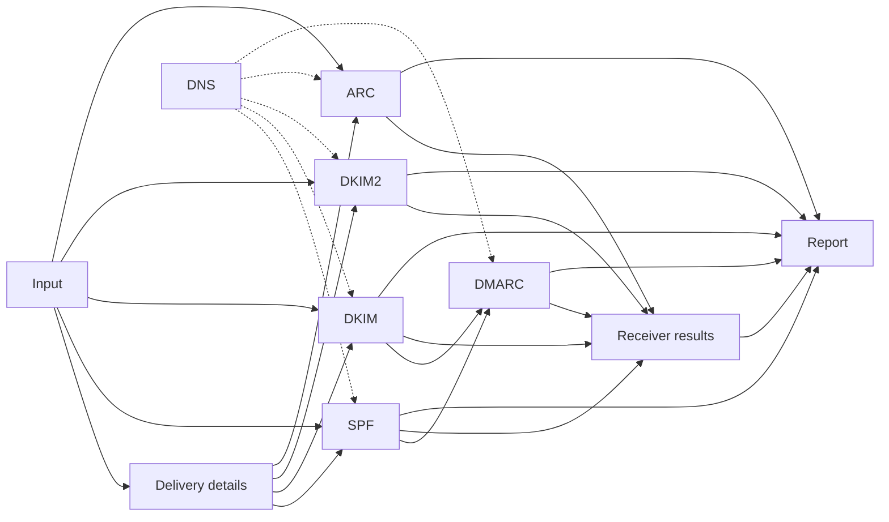

# Mail analyzer specification

Exact behavior of `@benchside/mail`. Why each feature exists: [requirements](../../explanation/requirements/).

Each rule has an ID (for example `SPF-5`). Test scenarios cite these IDs.

## Pages

| Page | Covers |
|---|---|
| [Input](input.md) | Accepted bytes, header and MIME parsing, line endings |
| [Delivery details](envelope.md) | `Received` parsing, trust boundary, reference time |
| [DNS](dns.md) | Resolver contract, query policy, cache, budget |
| [SPF](spf.md) | RFC 7208 |
| [DKIM](dkim.md) | RFC 6376, RFC 8301, RFC 8463 |
| [DKIM2](dkim2.md) | draft-ietf-dkim-dkim2-spec-07 (experimental) |
| [DMARC](dmarc.md) | RFC 7489 and RFC 9989 |
| [ARC](arc.md) | RFC 8617 |
| [Receiver results](authres.md) | RFC 8601 parsing and comparison |
| [Report](report.md) | Output data model, header fields, summary rules, findings |
| [Citations](citations.md) | The RFC section behind each evaluation step, as shown on the page |

## Conventions

| Term | Meaning |
|---|---|
| Result | A method's outcome, using the RFC's own result names |
| `not-evaluated` | The method could not run. Always carries a reason. Never a failure |
| Finding | A diagnostic with ID, severity, message, evidence ([Report](report.md#data-model)) |
| Reference time | The time used for time-based checks ([Delivery details](envelope.md#reference-time)) |
| Delivery details | Client IP, HELO, MAIL FROM, RCPT TO ([Delivery details](envelope.md)) |

## Limits

| Limit | Value | When exceeded |
|---|---|---|
| Input size | 50 MiB | `input.too-large`; no analysis |
| Header fields | 10 000 | `input.too-many-headers`; analysis stops |
| MIME depth | 32 | `input.mime-too-deep`; deeper parts not parsed |
| DKIM signatures verified | 20 | `dkim.too-many-signatures`; the rest `not-evaluated` |
| ARC sets | 50 | Chain `fail` (RFC 8617 §5.2) |
| DNS queries per analysis | 200 | `dns.budget-exhausted`; remaining lookups `temperror` |
| DNS timeout per query | 5 s | `temperror` |
| Analysis wall time | 60 s | `analysis.timeout`; unfinished methods `not-evaluated` |
