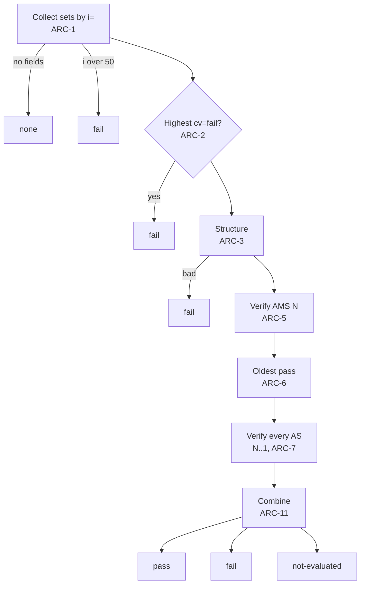

# ARC

Standard: RFC 8617 (Experimental).

## Validation (RFC 8617 §5.2)

Results: `none`, `pass`, `fail`, `not-evaluated`.

| ID | Rule |
|---|---|
| ARC-1 | Group `ARC-Authentication-Results` (AAR), `ARC-Message-Signature` (AMS), `ARC-Seal` (AS) by `i=`. No fields: `none`. Highest `i` over 50: `fail`, `arc.too-many-sets` (RFC 8617 §4.2.1). |
| ARC-2 | Highest set's AS has `cv=fail`: `fail`, `arc.cv-fail`. |
| ARC-3 | Structure: every field has an `i=` of 1 to 50; exactly one AAR, AMS, AS per instance; instances 1…N without gaps; set 1 `cv=none`; sets > 1 `cv=pass`; each AMS and AS passes its tag checks (ARC-5, ARC-7). Violation: `fail`, `arc.structure`. No signature is verified. |
| ARC-4 | Any error in the chain, including DNS errors, gives `fail` (RFC 8617 §5.2). The finding records the cause. Limits of this tool are not errors in the chain: see ARC-11. |

## Signatures

| ID | Rule |
|---|---|
| ARC-5 | AMS is verified like a DKIM signature ([DKIM-7..14](dkim.md)). Required tags: `i`, `a`, `b`, `bh`, `d`, `h`, `s`. `v` is ignored. Tag checks as DKIM-2, DKIM-4, DKIM-17, and DKIM-5 for `d`, `s`, `c`, `t`, `x`, `l` (`h` need not contain `from`; `i` is the instance). Time is not checked except ARC-9. Signature or body hash mismatch, or `l` longer than the canonical body: `arc.ams-mismatch`, with the cause in its message. |
| ARC-6 | Oldest pass: only when AMS N passes. Verify AMS N-1 down to 1; at the first failure at M, `oldestPass = M + 1`; if none fail, `oldestPass = 0`. Absent when an AMS on the way is `not-evaluated`. Does not change the result. |
| ARC-7 | Each AS: relaxed header canonicalization only. Input: for instances 1…i in order, that set's AAR, AMS, AS; the AS being verified has `b=` emptied, no trailing CRLF. Required tags: `i`, `cv`, `a`, `b`, `d`, `s`; `cv` is `none`, `pass`, or `fail`; other tag checks as for AMS. An AS with `h=` is a structure error. Mismatch: `arc.seal-mismatch`. |
| ARC-8 | Keys: as [DKIM-7..10](dkim.md#key). Algorithms: as [DKIM-4](dkim.md#signature-field). A key problem, or a DNS `SERVFAIL` or `TIMEOUT`: `arc.key`. |
| ARC-9 | AMS or AS `t` after reference time + 5 minutes: `arc.future-timestamp` (warning only). |
| ARC-11 | Combine the outcomes of AMS N and every AS (older AMS only feed ARC-6): any failure gives `fail`. Otherwise any `not-evaluated` gives `not-evaluated` with the first reason: `no-body` (header-only input; AMS cannot be checked), `offline`, `sensitive-query-blocked`, `budget-exhausted` (DNS-13). Otherwise `pass`. Every signature is checked, so the trace shows each hop. |
| ARC-12 | REP-7 and REP-8 apply to ARC as one method: `not-evaluated` with `internal-error` or `timeout`; the finding points at the ARC fields. |

## Trace

| ID | Rule |
|---|---|
| ARC-10 | One row per instance: `d`, `s`, `t`, `cv`, AMS result, AS result, the key query IDs, and the AAR content parsed per [AR-1](authres.md) after its `i=` tag. Per-signature results: `pass`, `fail`, `not-evaluated` (with reason), or `not-checked` (structure failed). |

## Findings

| Finding | Severity | Condition |
|---|---|---|
| `arc.too-many-sets` | error | ARC-1 |
| `arc.cv-fail` | error | ARC-2, or any set with `cv=fail` |
| `arc.structure` | error | ARC-3 |
| `arc.ams-mismatch` | error | ARC-5 |
| `arc.seal-mismatch` | error | ARC-7 |
| `arc.key` | error | ARC-8 |
| `arc.modified-after` | info | `oldestPass` > 1: a hop after `oldestPass − 1` changed the message |
| `arc.future-timestamp` | warning | ARC-9 |

Every finding's evidence is the fields involved, and the key query when there is one.
