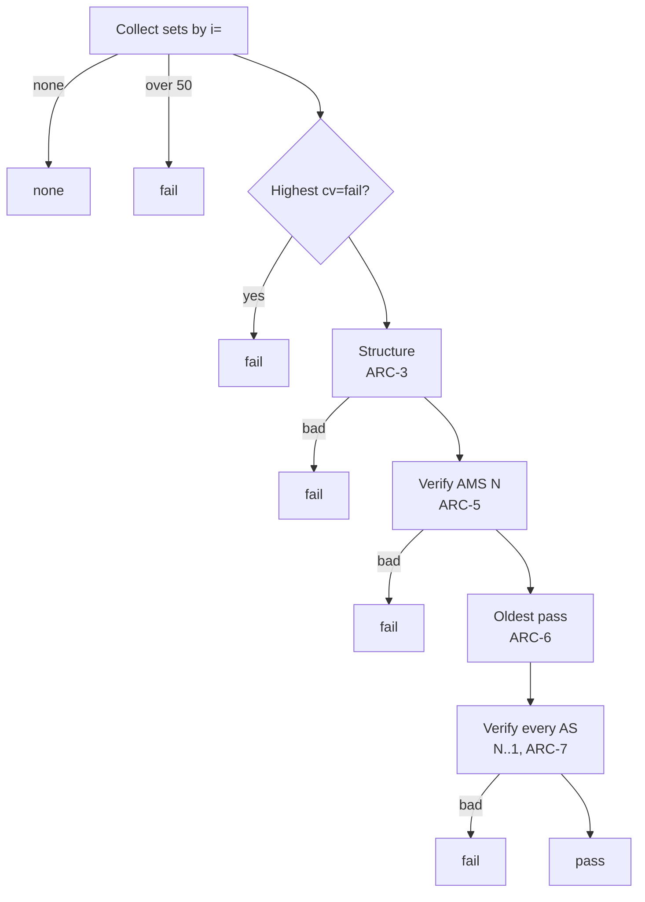

# ARC

Standard: RFC 8617 (Experimental).

## Validation (RFC 8617 §5.2)

Results: `none`, `pass`, `fail`, `not-evaluated`.

| ID | Rule |
|---|---|
| ARC-1 | Group `ARC-Authentication-Results` (AAR), `ARC-Message-Signature` (AMS), `ARC-Seal` (AS) by `i=`. No fields: `none`. Highest `i` over 50: `fail`. |
| ARC-2 | Highest set's AS has `cv=fail`: `fail`. |
| ARC-3 | Structure: exactly one AAR, AMS, AS per instance; instances 1…N without gaps; set 1 `cv=none`; sets > 1 `cv=pass`. Violation: `fail`, `arc.structure`. |
| ARC-4 | Any error, including DNS errors, gives `fail` (RFC 8617 §5.2.1). The finding records the cause. |

## Signatures

| ID | Rule |
|---|---|
| ARC-5 | AMS N is verified like a DKIM signature ([DKIM-7..14](dkim.md)) with these differences: no `v` (ignored if present); `i` is the instance; the AMS field itself is the signature field. Failure: `fail`, `arc.ams-mismatch`. |
| ARC-6 | Oldest pass: verify AMS N-1 down to 1; at the first failure at M, `oldestPass = M + 1`; if none fail, `oldestPass = 0`. Does not change the result. |
| ARC-7 | Each AS: relaxed header canonicalization only. Input: for instances 1…i in order, that set's AAR, AMS, AS; the AS being verified has `b=` emptied, no trailing CRLF. An AS with `h=`: `fail`. Tags: `i`, `cv`, `a`, `b`, `d`, `s`, `t`. Failure: `fail`, `arc.seal-mismatch`. |
| ARC-8 | Keys: as [DKIM-7..10](dkim.md#key). Algorithms: as [DKIM-4](dkim.md#signature-field). |
| ARC-9 | `t` after reference time + 5 minutes: `arc.future-timestamp` (warning only). |

## Trace

| ID | Rule |
|---|---|
| ARC-10 | One row per instance: `d`, `s`, `t`, `cv`, AMS result, AS result, and the AAR content parsed per [AR-1](authres.md). |

## Findings

| Finding | Severity | Condition |
|---|---|---|
| `arc.too-many-sets` | error | ARC-1 |
| `arc.cv-fail` | error | ARC-2, or any set with `cv=fail` |
| `arc.structure` | error | ARC-3 |
| `arc.ams-mismatch` | error | ARC-5 |
| `arc.seal-mismatch` | error | ARC-7 |
| `arc.key` | error | Key lookup or key error |
| `arc.modified-after` | info | `oldestPass` > 1: a hop after `oldestPass − 1` changed the message |
| `arc.future-timestamp` | warning | ARC-9 |
