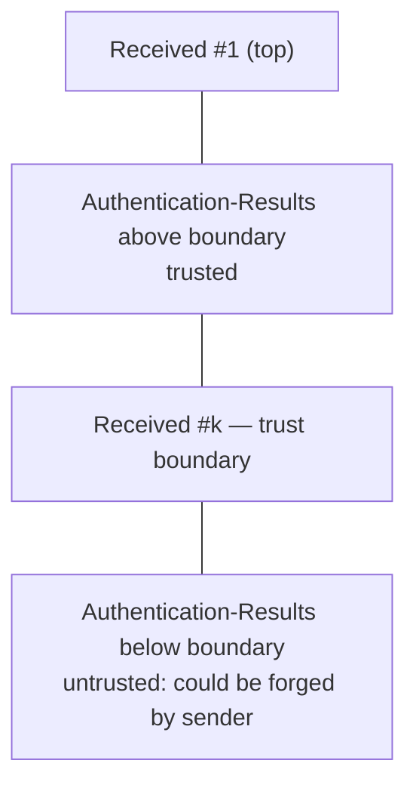

# Receiver results

Standards: RFC 8601 (`Authentication-Results`), RFC 7208 §9.1 (`Received-SPF`).

## Parsing

| ID | Rule |
|---|---|
| AR-1 | Parse `Authentication-Results`: `authserv-id`, optional version, then `method=result` entries with `reason` and `ptype.property=value`. Unparsable entries: `authres.syntax` (warning), skipped. |
| AR-2 | Parse `Received-SPF`: result, then key-value pairs (`client-ip`, `envelope-from`, `helo`, `identity`). |
| AR-3 | Methods compared: `spf`, `dkim`, `dmarc`, `arc`. Others are listed only. |

## Trust

| ID | Rule |
|---|---|
| AR-4 | A result field is trusted if it appears above the trust-boundary `Received` field ([ENV-8](envelope.md#trust-boundary)). Otherwise untrusted, `authres.untrusted` (info). |
| AR-5 | Only trusted fields are compared. Untrusted ones are listed. |

## Comparison

| ID | Rule |
|---|---|
| AR-6 | SPF: compare the receiver's `spf` result with ours for the identity in `smtp.mailfrom` (or `smtp.helo`). |
| AR-7 | DKIM: match entries by `header.d` and `header.s` (or `header.b` prefix) to our signatures. |
| AR-8 | DMARC: compare with our result in the selected mode. ARC: compare with our chain result. |
| AR-9 | Each difference produces `authres.differs` (warning) with likely causes from the table below. |

| Cause | Suggested when |
|---|---|
| Key changed since delivery | DKIM/ARC: receiver `pass`, ours `fail`/`permerror` with `dkim.no-key`, `dkim.key-revoked`, or `signature-mismatch` while `bh` matches |
| DNS changed since delivery | SPF or DMARC differs and no other cause applies |
| Forwarding or modification | Receiver `pass`, ours `fail` with `body-hash-mismatch` |
| Wrong trust boundary | SPF differs and our client IP differs from the receiver's `Received-SPF` `client-ip` |
| Line-ending conversion | `input.lf-converted` or `input.line-endings-mixed` present and any hash differs |

## Findings

| Finding | Severity |
|---|---|
| `authres.syntax` | warning |
| `authres.untrusted` | info |
| `authres.differs` | warning |
