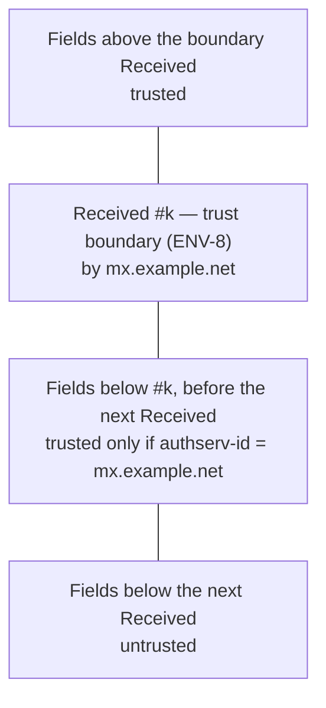

# Receiver results

Standard: RFC 8601 (`Authentication-Results`).

## Parsing

| ID | Rule |
|---|---|
| AR-1 | Parse `Authentication-Results`: `authserv-id`, optional version, then `method=result` entries with `reason` and `ptype.property=value`. Unparsable entries: `authres.syntax` (warning), skipped. |
| AR-12 | A field with no `authserv-id` (it starts with `method=result`, as Microsoft 365 writes it) gets `authres.syntax`. Its entries are still parsed and listed, with an empty `authserv-id`. |
| AR-13 | Tokens between `authserv-id` (and optional version) and the first `;` give `authres.syntax`. If they form an entry, it is kept. |
| AR-14 | A property without a `ptype` (for example `action=none`) is kept as written; it does not make the entry unparsable. A value may be a quoted local part followed by `@domain` (RFC 8601 §2.2 `pvalue`). |
| AR-2 | Retired. `Received-SPF` is not used. |
| AR-3 | Methods compared: `spf`, `dkim`, `dmarc`, `arc`. Others are listed only. |

## Trust

The boundary hop may write its results above or below its own `Received` field.
Gmail, for example, writes them below.

| ID | Rule |
|---|---|
| AR-4 | An `Authentication-Results` field is trusted if (a) it appears above the trust-boundary `Received` field ([ENV-8](envelope.md#trust-boundary)), or (b) it appears below that field and above the next `Received` field (or the end of the header block), and its `authserv-id` equals the boundary field's `by` host, compared case-insensitively. Otherwise it is untrusted, with `authres.untrusted` (info). |
| AR-5 | Only trusted fields are compared. Untrusted ones are listed. |

Rule AR-4 (b) relies on RFC 8601 §5. A border MTA must delete incoming fields that claim its own `authserv-id`. So a field below the boundary that carries the boundary host's ID was written by that host.

## Listing

| ID | Rule |
|---|---|
| AR-10 | Every `Authentication-Results` field is listed in header order with its field index, trust (AR-4), `authserv-id`, and entries. This holds whether or not our own results exist. |
| AR-11 | A method is compared only when our result for it exists. Otherwise its entries are listed without a comparison, and no `authres.differs` is produced. |

## Comparison

| ID | Rule |
|---|---|
| AR-6 | SPF: compare the receiver's `spf` result with ours for the identity in `smtp.mailfrom` (or `smtp.helo`). |
| AR-7 | DKIM: match entries by `header.d` and `header.s` (or `header.b` prefix) to our signatures. |
| AR-8 | DMARC: compare with our result in the selected mode. ARC: compare with our chain result. |
| AR-9 | Each difference produces `authres.differs` (warning) with likely causes from the table below. |

| Cause | Suggested when |
|---|---|
| Key changed since delivery | DKIM/ARC: receiver `pass`, ours `fail`/`permerror` with `dkim.no-key`, `dkim.key-revoked`, or `signature-mismatch` while `bh` matches |
| DNS changed since delivery | SPF or DMARC differs and no other cause applies |
| Forwarding or modification | Receiver `pass`, ours `fail` with `body-hash-mismatch` |
| Wrong trust boundary | SPF differs and the boundary came from ENV-9 (no public hop) or was chosen by the user (ENV-10) |
| Line-ending conversion | `input.lf-converted` or `input.line-endings-mixed` present and any hash differs |

## Findings

| Finding | Severity |
|---|---|
| `authres.syntax` | warning |
| `authres.untrusted` | info |
| `authres.differs` | warning |
