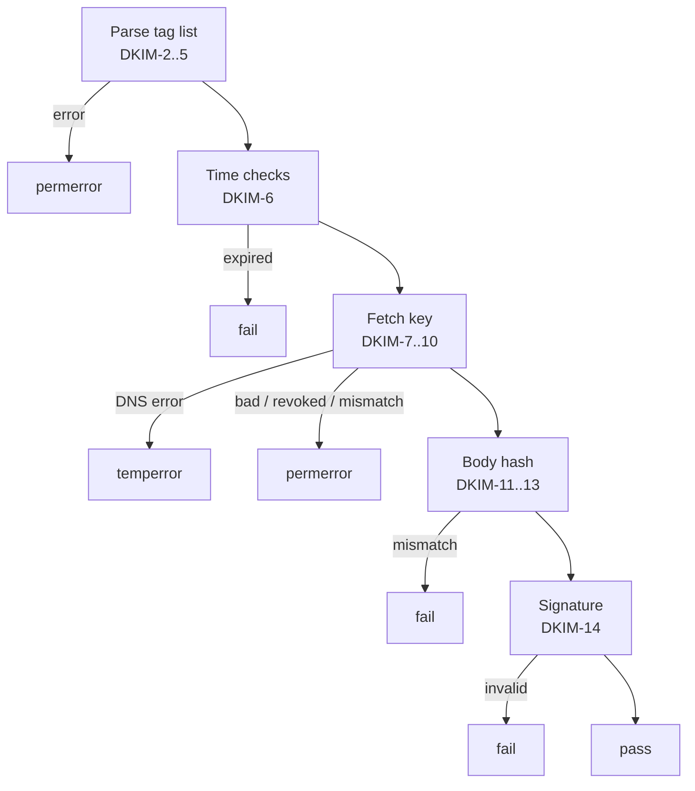

# DKIM

Standards: RFC 6376; RFC 8301 (algorithms, key sizes); RFC 8463 (Ed25519).

## Procedure per signature

| ID | Rule |
|---|---|
| DKIM-1 | Each `DKIM-Signature` field is verified independently, top to bottom. At most 20; the rest are `not-evaluated` with `dkim.too-many-signatures`. |

Results: `none` (no signatures), `pass`, `fail`, `neutral`, `temperror`, `permerror`, `not-evaluated`.

## Signature field

| ID | Rule | On violation |
|---|---|---|
| DKIM-2 | Tag-list syntax (RFC 6376 §3.2). Duplicate tags | `permerror`, `dkim.syntax` |
| DKIM-3 | Required tags: `v`, `a`, `b`, `bh`, `d`, `h`, `s`. `v=1` | `permerror`, `dkim.missing-tag` |
| DKIM-4 | `a`: `rsa-sha256`, `ed25519-sha256`. `rsa-sha1`: verified, but result `fail` (RFC 8301 §3.1). Other: | `permerror`, `dkim.unknown-algorithm` |
| DKIM-5 | `h` includes `from`. `i`, if present, is `d` or its subdomain. `c` values are `simple` or `relaxed`. `x` > `t` when both present | `permerror`, `dkim.invalid-tag` |

## Time

| ID | Rule |
|---|---|
| DKIM-6 | `x` before the [reference time](envelope.md#reference-time): `fail`, `dkim.expired`. `t` after reference time + 5 minutes: `dkim.future-timestamp` (warning only). |

## Key

| ID | Rule | On violation |
|---|---|---|
| DKIM-7 | Query TXT `<s>._domainkey.<d>` (type `domain`). DNS error | `temperror` |
| DKIM-8 | NXDOMAIN or NODATA | `permerror`, `dkim.no-key` |
| DKIM-9 | Key syntax. Empty `p=` | `permerror`, `dkim.key-syntax` / `dkim.key-revoked` |
| DKIM-10 | `k` matches `a` (default `rsa`). `h`, if present, lists the hash. `s` includes `email` or `*`. `t=s` and `i` is a subdomain of `d`. RSA modulus under 1024 bits (RFC 8301 §3.2) | `permerror`, `dkim.key-mismatch` / `dkim.key-too-short` |

Several key records: use the first that parses; `dkim.multiple-keys` (warning).

## Hashes and signature

| ID | Rule |
|---|---|
| DKIM-11 | Body canonicalization `simple` or `relaxed` (RFC 6376 §3.4.3, §3.4.4). |
| DKIM-12 | `l=`: hash only the first `l` bytes of the canonicalized body. `l` larger than the body: `permerror`, `dkim.invalid-tag`. |
| DKIM-13 | Body hash differs from `bh`: `fail`, `dkim.body-hash-mismatch`. Header-only input: `not-evaluated` (reason `no-body`). |
| DKIM-14 | Header selection per RFC 6376 §5.4.2 (bottom-up, missing fields as empty, oversigning). Header canonicalization per §3.4.1, §3.4.2. The signature field itself with `b=` emptied, no trailing CRLF. Invalid signature: `fail`, `dkim.signature-mismatch`. |
| DKIM-15 | `t=y` on the key: result unchanged; `dkim.testing` (info). |

## Trace

| ID | Rule |
|---|---|
| DKIM-16 | Per signature: parsed tags, key query ID, selected header fields with indexes, canonicalized header data, canonicalized body (or its first 64 KiB plus length), computed and expected `bh`. |

## Findings

| Finding | Severity | Condition |
|---|---|---|
| `dkim.syntax` | error | DKIM-2 |
| `dkim.missing-tag` | error | DKIM-3 |
| `dkim.unknown-algorithm` | error | DKIM-4 |
| `dkim.sha1` | error | `a=rsa-sha1` |
| `dkim.invalid-tag` | error | DKIM-5, DKIM-12 |
| `dkim.expired` | error | DKIM-6 |
| `dkim.no-key` | error | DKIM-8 |
| `dkim.key-syntax` | error | DKIM-9 |
| `dkim.key-revoked` | error | Empty `p=` |
| `dkim.key-mismatch` | error | DKIM-10, except key size |
| `dkim.key-too-short` | error | RSA under 1024 bits |
| `dkim.body-hash-mismatch` | error | DKIM-13 |
| `dkim.signature-mismatch` | error | DKIM-14 |
| `dkim.too-many-signatures` | warning | More than 20 signatures |
| `dkim.multiple-keys` | warning | Several key records |
| `dkim.body-length` | warning | `l=` present |
| `dkim.from-not-oversigned` | warning | `from` appears in `h` no more times than `From` fields exist |
| `dkim.unsigned-header` | warning | `Subject`, `Date`, `To`, `Cc`, `Reply-To`, `Message-ID`, or `Content-Type` present but not in `h` |
| `dkim.weak-key` | warning | RSA 1024–2047 bits |
| `dkim.future-timestamp` | warning | DKIM-6 |
| `dkim.testing` | info | Key `t=y` |
