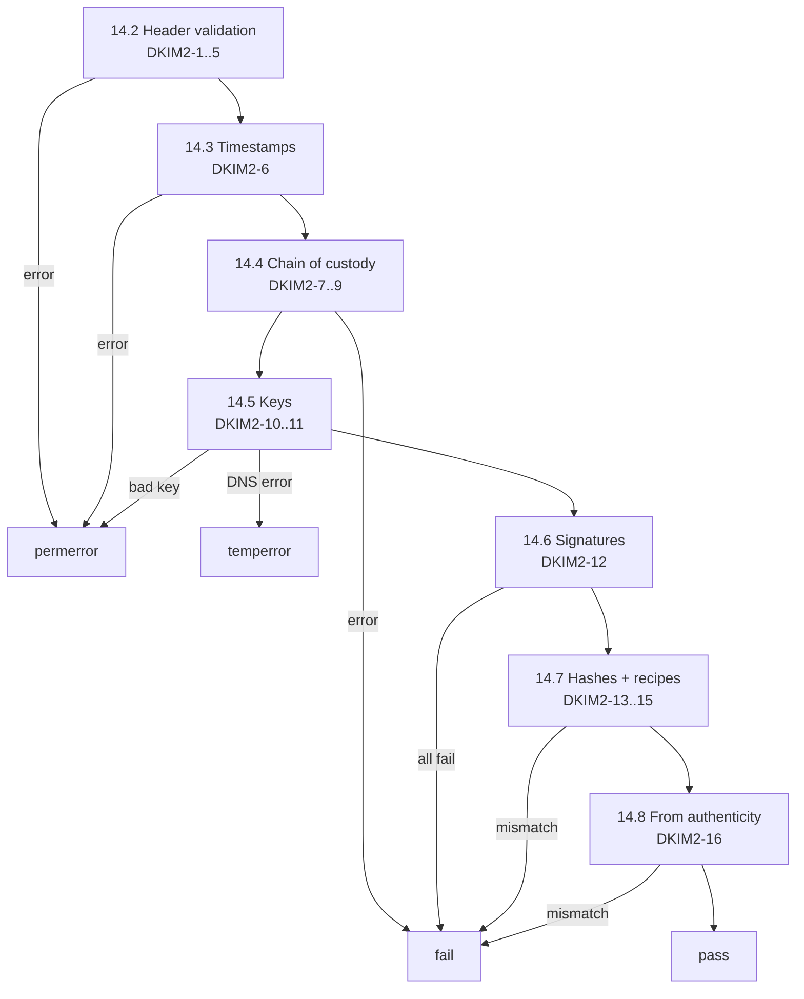

# DKIM2

Standard: [draft-ietf-dkim-dkim2-spec-07](https://datatracker.ietf.org/doc/html/draft-ietf-dkim-dkim2-spec-07). Key records: [draft-ietf-dkim-dkim2-dns-02](https://datatracker.ietf.org/doc/draft-ietf-dkim-dkim2-dns/).

**Experimental. Pinned to draft-07.** Every DKIM2 result carries `draft: "draft-ietf-dkim-dkim2-spec-07"`.

## Procedure (draft §14)

Results: `none` (no DKIM2 fields), `pass`, `fail`, `permerror`, `temperror`, `not-evaluated`. Plus stage: `provisionally-verified` or `validly-signed` (DKIM2-17).

## Header validation

| ID | Rule |
|---|---|
| DKIM2-1 | `Message-Instance` tags: `m` (required), `h` (required), `r`. `DKIM2-Signature` tags: `i`, `m`, `t`, `d`, `s` (required); `mf`+`rt` or `nd` (exactly one form); `f`, `n`. |
| DKIM2-2 | Duplicate tag in one field, or missing required tag: `permerror`, `dkim2.syntax`. Unknown tags ignored. |
| DKIM2-3 | `i` and `m` values start at 1 with no gaps. Highest `Message-Instance` `m` ≤ highest signature `m`. Violation: `permerror`, `dkim2.numbering`. |
| DKIM2-4 | In `h`: a hash algorithm repeated. In `s`: a selector repeated, or one signing algorithm used more than twice. Violation: `permerror`, `dkim2.syntax`. |
| DKIM2-5 | `r` is base64 JSON with keys `h` and `b`. Undecodable: `permerror`, `dkim2.recipe-invalid`. |

## Timestamps

| ID | Rule |
|---|---|
| DKIM2-6 | For each signature, against the [reference time](envelope.md#reference-time): `t` more than 14 days earlier → `permerror`, `dkim2.expired`; more than 1 day later → `permerror`, `dkim2.future`. |

## Chain of custody

| ID | Rule |
|---|---|
| DKIM2-7 | For `i` = 2…N in order: if `mf` is non-null, it relaxed-matches an `rt` address of signature `i-1`; if null, `d` relaxed-matches an `rt` address of `i-1`. If `i-1` has `nd`, `d` equals it exactly. Violation: `fail`, `dkim2.custody-broken`. |
| DKIM2-8 | For each signature with non-null `mf` and no `nd`: `d` relaxed-matches the `mf` domain. Violation: `fail`, `dkim2.custody-broken`. |
| DKIM2-9 | Signature N against [delivery details](envelope.md): MAIL FROM equals `mf`; every RCPT TO appears in `rt`. Local parts exact; domains case-insensitive. Violation: `fail`, `dkim2.envelope-mismatch`. Delivery details missing: this rule `not-evaluated`; stage at most `provisionally-verified`. |

Relaxed match: compare case-insensitively; on mismatch drop the leftmost label of the first argument and retry; stop when no dot remains. Domain literals never match.

## Keys and signatures

| ID | Rule |
|---|---|
| DKIM2-10 | Query TXT `<selector>._domainkey.<d>`. Timeout or SERVFAIL: `temperror`. Absent, several records, syntax error, revoked, or algorithm mismatch: `permerror`, `dkim2.key`. Key `h=` is ignored. |
| DKIM2-11 | Algorithms: `rsa-sha256` (RSA ≥ 1024 bits), `ed25519-sha256`. `mldsa44-ed25519-sha512`: that selector `not-evaluated`, `dkim2.unsupported-algorithm`. |
| DKIM2-12 | Signature input as the draft defines: all `Message-Instance` (ascending `m`), then all `DKIM2-Signature` (ascending `i`), signature values emptied. Verify every supported selector of every signature. Any failure: `dkim2.signature-mismatch`; all checkable selectors fail: `fail`. |

## Hashes and recipes

| ID | Rule |
|---|---|
| DKIM2-13 | Header hash as the draft defines: drop ignored fields and all DKIM2 fields, lowercase names, unfold, collapse WSP, sort by name (same names bottom-up). Body hash: DKIM `simple` body canonicalization. |
| DKIM2-14 | Compare with the highest `Message-Instance`. Any listed hash algorithm failing: `fail`, `dkim2.hash-mismatch`. Header-only input: body hash `not-evaluated`. |
| DKIM2-15 | Apply recipes from the highest instance down to rebuild each earlier version and check its hashes. `b: null` → that body and earlier ones `not-evaluated`. Each rebuilt version is kept for diff display. Recipe steps per version capped at 10 000; over the cap: `dkim2.recipe-too-complex`, `not-evaluated`. |

## From authenticity

| ID | Rule |
|---|---|
| DKIM2-16 | The current `From` domain, and each earlier `From` shown by recipes, relaxed-matches the `d` of the relevant signature, as the draft defines. A `From` with several addresses or a domain literal: `fail`, `dkim2.from-mismatch`. |

## Stages

| ID | Rule |
|---|---|
| DKIM2-17 | `provisionally-verified`: signature N verifies and the highest instance's hashes match. `validly-signed`: all rules pass. |

## Out of scope

- `f=exploded` and replay detection (draft §15): shown as raw flags only.
- Comparing with `Authentication-Results` (method defined in a separate draft): `not-evaluated`.

## Findings

| Finding | Severity |
|---|---|
| `dkim2.syntax` | error |
| `dkim2.numbering` | error |
| `dkim2.recipe-invalid` | error |
| `dkim2.recipe-too-complex` | warning |
| `dkim2.expired` / `dkim2.future` | error |
| `dkim2.custody-broken` | error |
| `dkim2.envelope-mismatch` | error |
| `dkim2.key` | error |
| `dkim2.unsupported-algorithm` | info |
| `dkim2.signature-mismatch` | error |
| `dkim2.hash-mismatch` | error |
| `dkim2.from-mismatch` | error |
