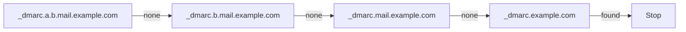

# DMARC

Standards: RFC 7489 and RFC 9989. Mode `rfc9989` (default) or `rfc7489`.

## Procedure

Results: `pass`, `fail`, `none`, `temperror`, `permerror`, `not-evaluated`.

## Author domain

| ID | Rule |
|---|---|
| DMARC-1 | No `From` field, or more than one: `not-evaluated`, `dmarc.from-invalid`. |
| DMARC-2 | `rfc9989`: the `From` field must yield exactly one domain. Several addresses with one domain: evaluate it, `dmarc.from-multiple-addresses` (warning). Several domains: `not-evaluated`, `dmarc.from-invalid` (RFC 9989 §5.3.1). |
| DMARC-3 | `rfc7489`: several domains → evaluate each; the result is `fail` if any fails, and the strictest failing policy applies (RFC 7489 §6.6.1). |

## Policy discovery: `rfc9989` (RFC 9989 §4.10)

| ID | Rule |
|---|---|
| DMARC-4 | Query `_dmarc.<author domain>`. A valid record there is the policy record. |
| DMARC-5 | Otherwise walk: if the author domain has more than 8 labels, start at its rightmost 7 labels; else at its parent. Query `_dmarc.<name>`, then drop the leftmost label and repeat. At most 8 queries in total, including DMARC-4. |
| DMARC-6 | Organizational domain (§4.10.2), longest name first: record with `psd=n` → that name; `psd=y` (not at the author domain) → one label below it; else the shortest name with a record. Policy record: the first valid record found. |

## Policy discovery: `rfc7489` (RFC 7489 §6.6.3)

| ID | Rule |
|---|---|
| DMARC-7 | Organizational domain: Public Suffix List snapshot, ICANN and private sections, standard algorithm (longest matching rule, exceptions, wildcard). The report records the matched rule and the snapshot date. |
| DMARC-8 | Query `_dmarc.<author domain>`; if no record, `_dmarc.<organizational domain>` when different. |

## Record

| ID | Rule |
|---|---|
| DMARC-9 | Keep TXT records starting with `v=DMARC1`. Several at one name: discard all, `dmarc.multiple-records`. DNS error during discovery: `temperror`. |
| DMARC-10 | Tags per mode. Common: `v p sp adkim aspf rua ruf fo`. `rfc9989` adds `np psd t`. `rfc7489` adds `pct rf ri`. Tags not defined for the mode: ignored, `dmarc.ignored-tag`. |
| DMARC-11 | Missing or invalid `p` (or invalid `sp`/`np`): if `rua` has a valid URI, treat as `p=none`; otherwise `not-evaluated`, `dmarc.invalid-policy`. `rfc9989`: missing `p` is `none`. |

## Alignment

| ID | Rule |
|---|---|
| DMARC-12 | SPF identifier: the SPF MAIL FROM identity's domain. Null reverse-path: the HELO domain via `postmaster@<HELO>` (RFC 7208 §2.4; RFC 7489 §4.1; RFC 9989 §3.2.4). The HELO identity's own result is never used. |
| DMARC-13 | DKIM identifiers: `d=` of each DKIM signature with result `pass`. DKIM2 is not used. |
| DMARC-14 | Strict (`s`): equal, case-insensitive. Relaxed (`r`, default): same organizational domain, computed by the mode's method. |

## Policy and disposition

| ID | Rule |
|---|---|
| DMARC-15 | Policy: record at the author domain → `p`. Record at the organizational domain → `sp` if the author domain exists, `np` (`rfc9989` only) if it does not; fallback `p`. |
| DMARC-16 | Existence (`rfc9989`): query `A` for the author domain. `NXDOMAIN` → does not exist; `NOERROR` (with or without data) → exists (RFC 9989 Appendix A.4). |
| DMARC-17 | `rfc9989` `t=y`: `reject` → `quarantine`, `quarantine` → `none`. |
| DMARC-18 | `rfc7489` `pct` < 100: report two dispositions with weights: selected (`pct`%) → policy; unselected → `quarantine` if policy is `reject`, else `none` (RFC 7489 §6.6.4). No random choice. |
| DMARC-19 | Result `pass` → disposition `none`. |

## Findings

| Finding | Severity | Condition |
|---|---|---|
| `dmarc.from-invalid` | error | DMARC-1, DMARC-2 |
| `dmarc.from-multiple-addresses` | warning | DMARC-2 |
| `dmarc.multiple-records` | error | DMARC-9 |
| `dmarc.invalid-policy` | error | DMARC-11 |
| `dmarc.ignored-tag` | info | DMARC-10 |
| `dmarc.policy-none` | info | Policy in effect is `none` |
| `dmarc.no-rua` | info | No valid `rua` |
| `dmarc.modes-differ` | info | Both modes evaluated and results or dispositions differ |
