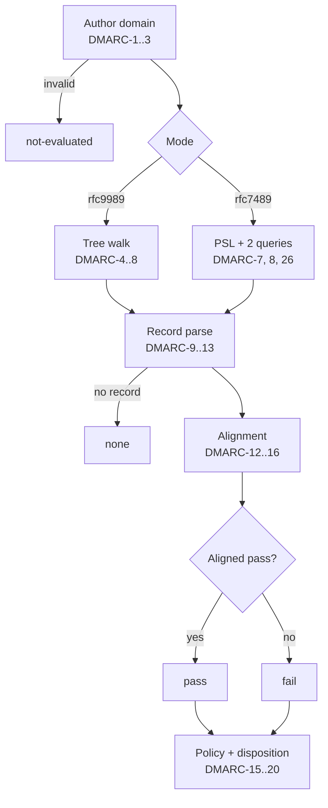
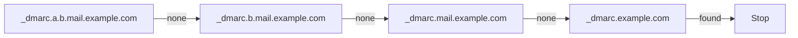

# DMARC

Standards: RFC 7489 and RFC 9989. Mode `rfc9989` (default) or `rfc7489`. The modes to evaluate are an analysis option; the default is `rfc9989` only (DMARC-27).

## Procedure

Results: `pass`, `fail`, `none`, `temperror`, `permerror`, `not-evaluated`.

## Author domain

| ID | Rule |
|---|---|
| DMARC-1 | No `From` field, or more than one: `not-evaluated`, `dmarc.from-invalid`. |
| DMARC-2 | `rfc9989`: the `From` field must yield exactly one domain. Several addresses with one domain: evaluate it, `dmarc.from-multiple-addresses` (warning). Several domains: `not-evaluated`, `dmarc.from-invalid` (RFC 9989 §5.3.1). |
| DMARC-3 | `rfc7489`: several domains → evaluate each on its own (RFC 7489 §6.6.1). Mode result: the first of `fail`, `permerror`, `temperror`, `not-evaluated`, `pass`, `none` that any domain has; `not-evaluated` takes the first such domain's reason. The mode's details come from the deciding domain: for `fail`, the failing domain with the strictest policy (`reject` > `quarantine` > `none`; `pct` does not count); otherwise, and on ties, the first domain in `From` order with the mode result. Each domain's own result is in `perDomain`. Several addresses in one domain: that domain once, no finding. |
| DMARC-21 | The `From` value is an RFC 5322 `address-list`: comments, quoted local parts, display names, and groups are allowed. Each address's domain is the text after its last `@`, lowercased. A domain literal, an address without `@`, or a domain that is not a domain name: `not-evaluated`, `dmarc.from-invalid`. |

## Policy discovery: `rfc9989` (RFC 9989 §4.10)

| ID | Rule |
|---|---|
| DMARC-4 | Query `_dmarc.<author domain>`. A valid record there is the policy record. |
| DMARC-5 | Otherwise walk: if the author domain has more than 8 labels, start at its rightmost 7 labels; else at its parent. Query `_dmarc.<name>`, then drop the leftmost label and repeat. At most 8 queries in total, including DMARC-4. |
| DMARC-6 | Organizational domain (§4.10.2), longest name first: record with `psd=n` → that name; `psd=y` (not at the author domain) → one label below it; else the shortest name with a record. Policy record: the first valid record found. |
| DMARC-22 | The walk keeps going after the policy record is found, so DMARC-6 sees every record up to its stop. It stops at a record with `psd=y` or `psd=n`, when no labels are left, or after 8 queries. No record at all: the organizational domain is the domain itself. A DNS error or `OFFLINE` after a record was found also ends the walk, without an error: the organizational domain comes from the records found so far. |

## Policy discovery: `rfc7489` (RFC 7489 §6.6.3)

| ID | Rule |
|---|---|
| DMARC-7 | Organizational domain: the Public Suffix List snapshot, ICANN and private sections (RFC 7489 §3.2). The public suffix comes from DMARC-26. The organizational domain is the public suffix plus one more label of the domain. A domain that is itself a public suffix is its own organizational domain. The report records the matched rule (`orgDomainRule`) and the snapshot's `VERSION` (`pslVersion`). |
| DMARC-26 | Public suffix ([PSL algorithm](https://github.com/publicsuffix/list/wiki/Format#formal-algorithm)): a rule matches when its labels equal the domain's rightmost labels; `*` matches any one label. Labels compare in lowercase. Rules with Unicode labels are matched in their A-label form (RFC 5891). An exception rule (`!`) wins; its public suffix is the rule without its leftmost label. Otherwise the matching rule with the most labels wins. No match: the default rule `*`, so the top-level label is the public suffix. |
| DMARC-8 | Query `_dmarc.<author domain>`; if no record, `_dmarc.<organizational domain>` when different. At most 2 queries. DNS outcomes as in DMARC-23. |

## Record

| ID | Rule |
|---|---|
| DMARC-9 | Keep TXT records starting with `v=DMARC1`. Several at one name: discard all, `dmarc.multiple-records`. DNS error during discovery: `temperror`. |
| DMARC-23 | A valid record: its first tag is `v=DMARC1` and its tag list parses (RFC 6376 §3.2 syntax). Other TXT records at the name are ignored. NXDOMAIN or NODATA: no record. `SERVFAIL`, `TIMEOUT`, `BUDGET`: `temperror`. `OFFLINE`: `not-evaluated` (reason `offline`). |
| DMARC-10 | Tags per mode. Common: `v p sp adkim aspf rua ruf fo`. `rfc9989` adds `np psd t`. `rfc7489` adds `pct rf ri`. Tags not defined for the mode: ignored, `dmarc.ignored-tag`. `rfc7489` `pct` that is not an integer from 0 to 100: ignored (so 100), `dmarc.ignored-tag` (RFC 7489 §6.3). |
| DMARC-11 | Missing or invalid `p` (or invalid `sp`/`np`): if `rua` has a valid URI, treat as `p=none`; otherwise `not-evaluated`, `dmarc.invalid-policy`. `rfc9989`: missing `p` is `none`. |

## Alignment

| ID | Rule |
|---|---|
| DMARC-12 | SPF identifier: the SPF MAIL FROM identity's domain. Null reverse-path: the HELO domain via `postmaster@<HELO>` (RFC 7208 §2.4; RFC 7489 §4.1; RFC 9989 §3.2.4). The HELO identity's own result is never used. |
| DMARC-13 | DKIM identifiers: `d=` of each DKIM signature with result `pass`. DKIM2 is not used. |
| DMARC-14 | Strict (`s`): equal, case-insensitive. Relaxed (`r`, default): same organizational domain, computed by the mode's method. |
| DMARC-24 | Result: `pass` if an identifier with result `pass` is aligned. Otherwise, if DKIM could not run at all (REP-7): `not-evaluated` with its reason. Otherwise, if an aligned identifier's result is `temperror`, or a DNS error stopped the organizational-domain lookup of an identifier with result `pass`: `temperror` (`not-evaluated` with the reason when the lookup was `OFFLINE`). Otherwise, if an aligned identifier is `not-evaluated`: `not-evaluated` with its reason. Otherwise `fail`. |
| DMARC-25 | Relaxed alignment looks up an identifier's organizational domain only when the identifier equals the author's organizational domain or ends with `.` + it; any other domain cannot align. |

## Policy and disposition

| ID | Rule |
|---|---|
| DMARC-15 | Policy: record at the author domain → `p`. Record at the organizational domain → `sp` if the author domain exists, `np` (`rfc9989` only) if it does not; fallback `p`. `rfc7489` does not check existence: record at the organizational domain → `sp`, fallback `p`. |
| DMARC-16 | Existence (`rfc9989`): query `A` for the author domain. `NXDOMAIN` → does not exist; `NOERROR` (with or without data) → exists (RFC 9989 Appendix A.4). |
| DMARC-17 | `rfc9989` `t=y`: `reject` → `quarantine`, `quarantine` → `none`. The report keeps the declared policy next to the one in effect. |
| DMARC-18 | `rfc7489` `pct` < 100 and result `fail`: `dispositions` lists two dispositions with weights: selected (`pct`%) → policy; unselected (100 − `pct`%) → `quarantine` if policy is `reject`, else `none` (RFC 7489 §6.6.4). `disposition` stays the policy. No random choice. |
| DMARC-19 | Result `pass` → disposition `none`. |

## Modes

| ID | Rule |
|---|---|
| DMARC-27 | The modes to evaluate are an analysis option: a non-empty set of `rfc9989` and `rfc7489`. Default: `rfc9989` only. Each selected mode is evaluated on its own; they run concurrently and share the DNS cache. |
| DMARC-28 | Both modes evaluated, and their results or dispositions differ: `dmarc.modes-differ` (info) in the report's findings, with the `From` field as evidence. |

## Findings

| Finding | Severity | Condition |
|---|---|---|
| `dmarc.from-invalid` | error | DMARC-1, DMARC-2 |
| `dmarc.from-multiple-addresses` | warning | DMARC-2 |
| `dmarc.multiple-records` | error | DMARC-9 |
| `dmarc.invalid-policy` | error | DMARC-11 |
| `dmarc.ignored-tag` | info | DMARC-10 |
| `dmarc.policy-none` | info | Policy in effect is `none` |
| `dmarc.no-rua` | info | No valid `rua` |
| `dmarc.modes-differ` | info | DMARC-28 |
