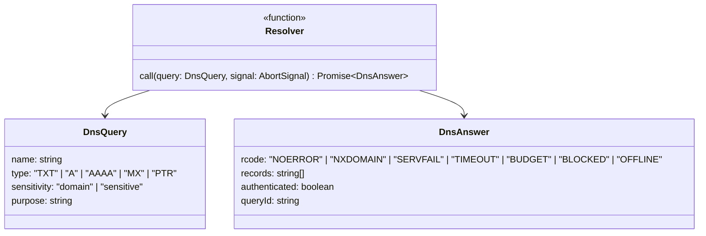
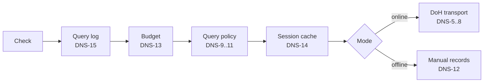

# DNS

## Resolver contract

| ID | Rule |
|---|---|
| DNS-1 | Checks call only the `Resolver`. They never call `fetch`. |
| DNS-2 | `NOERROR` with zero records is NODATA. NODATA and `NXDOMAIN` are distinct. |
| DNS-3 | `SERVFAIL`, `TIMEOUT` (5 s), `BUDGET` (DNS-13): the caller's result is `temperror`. |
| DNS-4 | `BLOCKED` (DNS-9) and `OFFLINE` (DNS-12): the caller's result is `not-evaluated`. |

## Layers

## DoH transport

| ID | Rule |
|---|---|
| DNS-5 | JSON API. Cloudflare (default): `GET https://cloudflare-dns.com/dns-query?name=…&type=…` with `Accept: application/dns-json`. Google: `GET https://dns.google/resolve?name=…&type=…`. |
| DNS-6 | No other parameters, headers, or cookies (`credentials: 'omit'`, `referrerPolicy: 'no-referrer'`). |
| DNS-7 | TXT data arrives as one or more quoted strings. Unquote each, unescape, and join without separators (RFC 7208 §3.3, RFC 6376 §3.6.2.2). |
| DNS-8 | `authenticated` is the response's `AD` flag. It is the provider's claim; benchside does not validate DNSSEC itself. |
| DNS-16 | Response `Status` 0 is `NOERROR`, 3 is `NXDOMAIN`; any other status, an HTTP error, a network error, or a body that is not the expected JSON is `SERVFAIL`. No answer within 5 s is `TIMEOUT`. |
| DNS-17 | Only answer records of the queried type are used. Others, such as `CNAME` steps, are ignored. |
| DNS-18 | Names are converted to A-labels (IDNA) before the cache, so both forms share one entry. A label containing `@`, `:`, `/`, `\`, `?`, `#`, `%`, `[`, `]`, whitespace, or anything that turns into a dot is not converted: the query is not sent and the answer is `SERVFAIL`. The log keeps the name as the check asked for it. |

## Query policy

| ID | Rule |
|---|---|
| DNS-9 | A query is `sensitive` if its name contains data beyond domain names from the message: an SPF macro expanding `%{l}`, `%{s}`, `%{i}`, `%{c}`, or `%{p}`; any `PTR` query; any reverse name (`in-addr.arpa`, `ip6.arpa`). |
| DNS-10 | `sensitive` queries return `BLOCKED` unless the user allowed sensitive queries for this analysis. |
| DNS-11 | Each blocked query is logged with the name it would have sent. |

## Offline mode

| ID | Rule |
|---|---|
| DNS-12 | No network requests. A query matching a user-entered record `(name, type)` returns it with `NOERROR`. Otherwise `OFFLINE`. |

## Budget, cache, log

| ID | Rule |
|---|---|
| DNS-13 | At most 200 queries per analysis, counted before the cache (cache hits count). Further queries return `BUDGET`, with `dns.budget-exhausted` (error). |
| DNS-14 | `NOERROR` and `NXDOMAIN` answers are cached in memory per `(source, name, type)` until the page closes; the source is the DoH provider or `offline`, and names compare case-insensitively. Other answers are not cached. Within one analysis, identical queries in flight share one request; across analyses only finished answers are shared. Never persisted. |
| DNS-15 | Every query is logged: `queryId`, name, type, sensitivity, purpose, rcode, records, `authenticated`, duration, cache hit. |

## Findings

| Finding | Severity | Condition |
|---|---|---|
| `dns.budget-exhausted` | error | Over 200 queries in one analysis |
| `dns.blocked-sensitive` | info | A sensitive query was blocked |
| `dns.unauthenticated` | info | An answer used for a result has `authenticated: false` |
| `dns.answers-are-current` | info | Always present: answers reflect DNS now, not at delivery |
