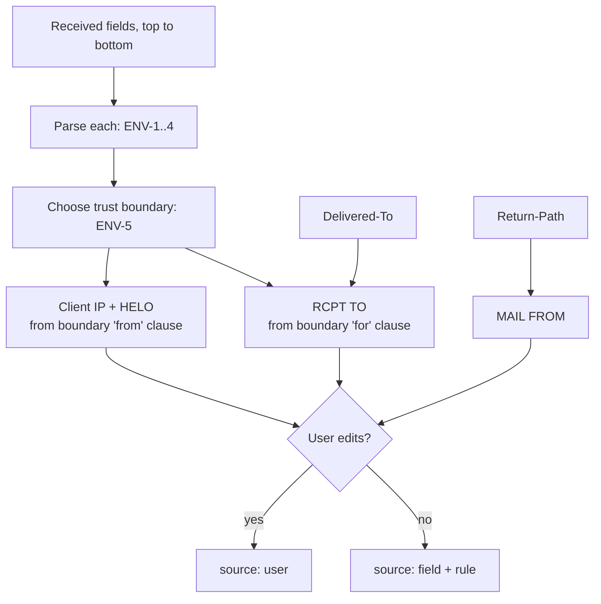

# Delivery details

SMTP session values that a stored message does not contain.

| Value | Used by |
|---|---|
| Client IP | SPF |
| HELO name | SPF |
| MAIL FROM | SPF, DMARC, DKIM2 |
| RCPT TO (one or more) | DKIM2 |

## Inference

## Parsing `Received`

| ID | Rule |
|---|---|
| ENV-1 | Try the RFC 5321 §4.4 grammar first: `from` Extended-Domain, `by`, optional `via` / `with` / `id` / `for`, `;` date-time. Comments may appear between clauses. A `from` clause without TCP-info yields no client IP, so it counts as a grammar failure. |
| ENV-2 | If the grammar fails, apply the heuristics below in order. The first match wins. |
| ENV-3 | The date-time is the text after the last `;` outside comments and quoted strings, parsed per RFC 5322 §3.3 and §4.3 (unknown alphabetic zones count as `-0000`). A missing zone, a year before 1900, or an impossible date: no time for this field. |
| ENV-4 | Each parsed field records `confidence`: `grammar`, `heuristic`, or `none`. |
| ENV-16 | The `by` host is the first atom after the first `by` keyword that follows the `from` keyword's domain, whatever the confidence. A sender's HELO name `by` is never taken as the keyword. Used by [AR-4](authres.md#trust). |

Heuristics (examples are synthetic):

| # | Pattern | Example | HELO | Client IP |
|---|---|---|---|---|
| H1 | `from HELO (RDNS [IP])` (Postfix, Sendmail) | `from mx.example.net (mx.example.net [192.0.2.1])` | `mx.example.net` | `192.0.2.1` |
| H2 | `from RDNS ([IP] helo=HELO)` (Exim) | `from host.example ([192.0.2.1] helo=mx.example.net)` | `mx.example.net` | `192.0.2.1` |
| H3 | `from HOST (IP) by …` (Microsoft) | `from mail.example.net (192.0.2.1) by …` | `mail.example.net` | `192.0.2.1` |
| H4 | `from HOST (HOST. [IP])` (Gmail) | `from mx.example.net (mx.example.net. [192.0.2.1])` | `mx.example.net` | `192.0.2.1` |
| H5 | Any `[IPv4]` or `[IPv6:…]` literal in the `from` clause | | `from` token | the literal |

| ID | Rule |
|---|---|
| ENV-17 | IPv4 octets are decimal, 1 to 3 digits (RFC 5321 Snum). Leading zeros are allowed: `010` is 10. |
| ENV-6 | IPv6 literals: accept `[IPv6:addr]`, `[addr]`, and bare `addr` inside parentheses. Normalize to RFC 5952 form. |
| ENV-7 | IPv4-mapped IPv6 (`::ffff:a.b.c.d`) is converted to IPv4. |

## Trust boundary

| ID | Rule |
|---|---|
| ENV-8 | Default: the topmost `Received` field whose client IP is a public address. Private (RFC 1918, RFC 6598, RFC 4193), loopback, link-local, unspecified (`0.0.0.0/8`, `::`), multicast, broadcast, and deprecated site-local (`fec0::/10`) addresses are skipped. Documentation ranges count as public. |
| ENV-9 | If none qualifies: the topmost `Received` field, with `envelope.no-public-hop` (warning). With no `Received` field at all, there is no boundary and no finding. |
| ENV-10 | The user can choose any `Received` field as the boundary. |

## Values

| ID | Value | Rule |
|---|---|---|
| ENV-11 | Client IP | From the boundary field |
| ENV-12 | HELO | From the boundary field |
| ENV-13 | MAIL FROM | The topmost `Return-Path`. `<>` means null reverse-path. Absent: `not-evaluated` |
| ENV-14 | RCPT TO | The boundary field's `for` clause; else all `Delivered-To` fields; else absent |
| ENV-15 | Each value records its source: `{ field index, rule ID }` or `user` |

## Reference time

| ID | Rule |
|---|---|
| TIME-1 | Options: `received` (boundary field's date-time), `date` (the `Date` field), `now`. |
| TIME-2 | Default `received`. If unavailable, `now`, with `envelope.time-fallback` (info) pointing at the boundary field. With no boundary (no `Received` field), `now` is used without a finding. `date` without a parsable `Date` field also falls back to `now`, with the finding pointing at the `Date` field if there is one. |
| TIME-3 | Used by DKIM `t=`/`x=`, DKIM2 `t=`, and ARC `t=`. |

## Findings

| Finding | Severity | Condition |
|---|---|---|
| `envelope.no-public-hop` | warning | No `Received` field with a public client IP |
| `envelope.unparsed-received` | info | A `Received` field with `confidence: none` |
| `envelope.time-fallback` | info | Reference time fell back to `now` |
| `envelope.multiple-return-path` | warning | More than one `Return-Path` field |
