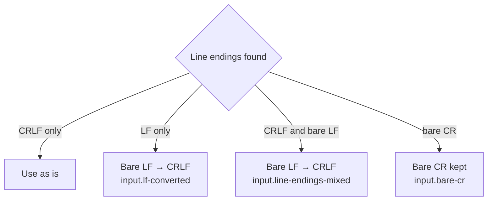

# Input

## Accepted input

| ID | Rule |
|---|---|
| IN-1 | Input is a byte sequence: a full message (RFC 5322) or a header block only. |
| IN-2 | Header-only input: the header block ends at the end of input. Body-dependent checks are `not-evaluated` (reason `no-body`). |
| IN-3 | Input over 50 MiB: `input.too-large` (error); nothing else runs. |
| IN-4 | All hashes are computed over the original bytes after line-ending normalization (IN-7). Decoded text is for display only. |

## Header block

| ID | Rule |
|---|---|
| IN-5 | The header block ends at the first empty line. Without one, the whole input is headers (IN-2). |
| IN-6 | Each field records: name, raw byte range (including folding), unfolded value. Field names compare case-insensitively. Lines without a colon: `input.malformed-header` (warning); the line is kept as raw bytes and ignored by checks. |

## Line endings

| ID | Rule |
|---|---|
| IN-7 | Every LF not preceded by CR becomes CRLF. Bare CR is unchanged. |
| IN-8 | The normalized bytes are used for all checks. Byte ranges in the report refer to the original bytes. |
| IN-13 | Evidence for line-ending findings uses original offsets: `input.lf-converted` and `input.line-endings-mixed` point at the first bare LF; `input.bare-cr` points at each bare CR, up to 100. |

| Finding | Severity | Condition |
|---|---|---|
| `input.lf-converted` | warning | Only bare LF line endings. Hashes may differ from the signer's |
| `input.line-endings-mixed` | warning | Both CRLF and bare LF |
| `input.bare-cr` | warning | CR not followed by LF |

## MIME

| ID | Rule |
|---|---|
| IN-9 | Parses the MIME tree (RFC 2045, RFC 2046): content type, parameters, transfer encoding, byte range per part. |
| IN-10 | Depth over 32: `input.mime-too-deep` (warning); deeper parts are kept as opaque bytes. |
| IN-11 | Missing or unmatched boundaries: `input.mime-boundary` (warning); the part extends to the end of its parent. |
| IN-12 | Header values are decoded for display: RFC 2047 encoded words, and UTF-8 per RFC 6532. Undecodable words are shown raw with `input.encoded-word` (info). |

## Other findings

| Finding | Severity | Condition |
|---|---|---|
| `input.too-large` | error | Input over 50 MiB |
| `input.too-many-headers` | error | More than 10 000 header fields |
| `input.malformed-header` | warning | A header line without a colon |
